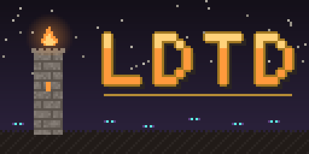
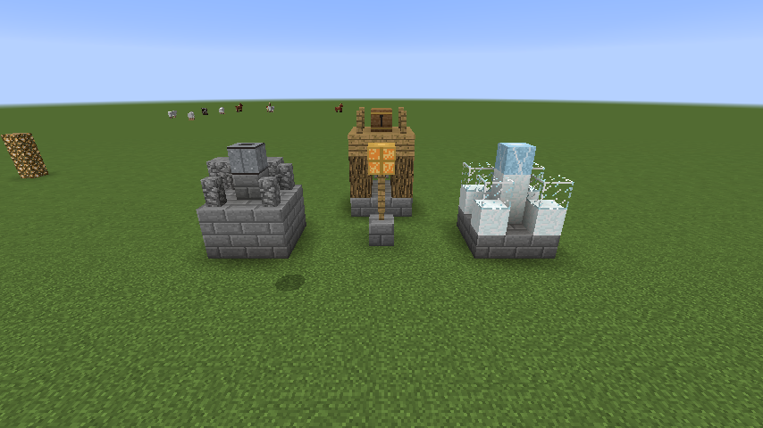
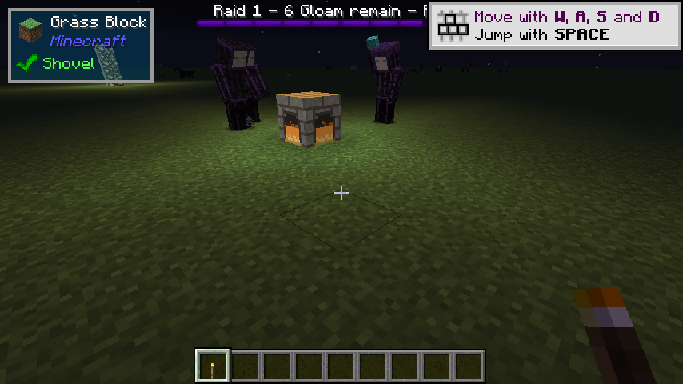
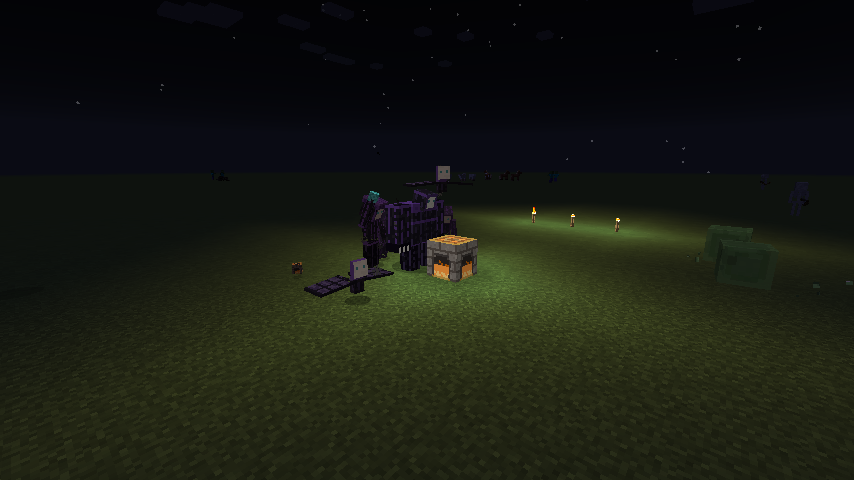
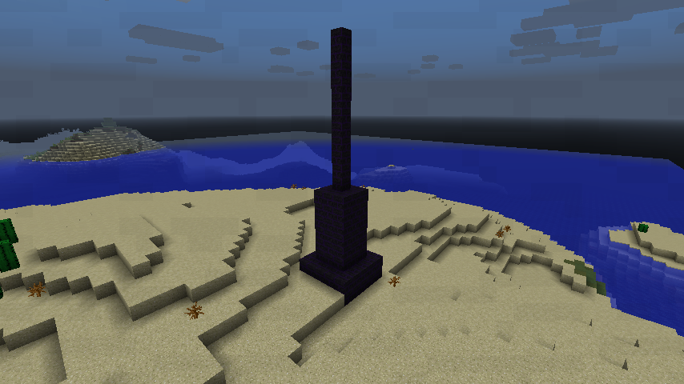

<p align="center"></p>

# LDTD: Limitless Development: Tower Defense

A survival **tower defense** mod for **Minecraft 1.12.2 (Forge)**.

Claim your base, or a village, with a **Hearth**. Hearth-sprites build towers and walls from your
blueprints, block by block, with materials from the Hearth's stockpile. When night falls, the
**Gloam** come for your flame. Hold the line, grow your Hearth, then take the fight to the Dusk
Spires that send them, and face the Eclipse.

**[Read the LDTD Wiki](https://mica-technologies.github.io/LDTD/)** for guides, every tower and
Gloam unit, raids, commands, configuration and the data files.



## How to play

1. **Craft a Hearth** (fire charge, gold ingots, a furnace, stone bricks) and set it down. The
   land around it is now your territory. Every player gets *The Hearthkeeper's Guide* the first
   time they join, and `/hearth guide` gives another copy.
2. **Fill the stockpile.** Use the Hearth to open it.
3. **Order defenses.** Craft a blueprint, hold it to see a ghost of the build, and use it inside
   your territory. Hearth-sprites carry materials from the stockpile and build it, then mend
   whatever the Gloam break.
4. **Survive the night.** On nights when you are near, a raid gathers at your border, and you're
   told from which side. Each Gloam that reaches the Hearth drains its Flame. If the Flame goes
   out, the Hearth falls dark until you relight it with coal.
5. **Grow.** Every raid survived pays **Duskglass**, and the Gloam drop it too. Feed it to the
   Hearth for a wider territory, more sprites and a greater hall. Use it on a tower's core to
   upgrade the tower.
6. **Strike back.** Dusk Spires stand in the wilds, feeding and aiming the raids on any Hearth
   near them. Dig to a spire's core and break it. When three have fallen near a Hearth, the
   Eclipse comes.



## Features

- **Hearths:** they claim a territory, hold a stockpile, keep Hearth-sprites and grow through
  five levels, raising a bigger hall as they go. Villages may have an unclaimed Hearth in a
  Hearth Square, ready to be taken up.
- **Five towers, three tiers each:** Archer (steady shots), Cannon (splash), Frost (slows
  everything in reach), Lantern (light that weakens the Gloam) and Guard Post (Ember Guards you
  command with a Command Brand). Walls too. Every tower is real blocks the Gloam have to get
  through.
- **The Gloam:** an original night faction of six units, from the common Shade to the
  light-snuffing Smother, the blinking Flicker, the flying Moth-wraith, the ranged Dimcaster, and
  the Eclipse.
- **Raids that route and siege:** the Gloam plan a path to the Hearth around your walls. When
  walls block the way, they break through, and only ever inside a Hearth's territory.
- **Raids that scale:** each raid is bought from a budget that grows with every night survived
  and every level gained, and late raids send tougher Gloam. The balance is checked by an offline
  simulator in the test suite.
- **Dusk Spires and the Eclipse:** enemy outposts generate in the world, guarded at night. Raze
  them to weaken the raids, and to call out the boss.
- **Territory protection:** players the owner hasn't trusted can't build, break or open the
  stockpile in a territory.
- **Data-driven:** towers, Gloam, raids, Hearth levels and blueprints are JSON under
  `config/ldtd/`. Edit them and run `/ldtd reload`. A broken file never takes the server down,
  and older files are brought up to date automatically when LDTD updates.



## Commands

The [wiki's command reference](https://mica-technologies.github.io/LDTD/reference/commands/) has every
option in full.


- `/hearth guide`: a copy of *The Hearthkeeper's Guide*.
- `/hearth trust <player>`, `/hearth untrust <player>`, `/hearth trusted`: who may build in your
  territory and use your stockpile. Run them while standing in your territory.
- `/randomspawn` (or `/rs`): teleports you to a random safe spot, for finding fresh ground for a
  Hearth. On a world that is already explored, it only picks chunks that have been generated. On a
  new world, smaller than 1000 blocks from spawn, it may pick anywhere within that radius. Open to
  all players with a 5-minute cooldown. Operators skip the cooldown and can send others
  (`/rs <player>`).
- `/ldtd ...`: operator tools: `reload`, `hearth`, `raid start|stop`, `spire place|list`, `spawn`,
  `route show` and `debug`.

## Configuration

See the wiki's [configuration](https://mica-technologies.github.io/LDTD/reference/configuration/)
and [data file](https://mica-technologies.github.io/LDTD/reference/data-files/) pages for every option.

`config/ldtd.cfg` holds the switches: raids, griefing, protection rules, random spawn, Dusk
Spires, village buildings, the guide, and the client's borders and health bars. The JSON files in
`config/ldtd/` hold the balance numbers.



## Building

See also [Building from source](https://mica-technologies.github.io/LDTD/contributing/building/) on the wiki.


Needs a JDK 17-22 for Gradle (21 recommended). The mod itself targets Java 8.

```bash
./gradlew build      # compile, unit tests, jar in build/libs/
./gradlew runClient  # dev client
./gradlew runServer  # dev dedicated server
```

## License

[MIT](LICENSE). Third-party notices are in [CREDITS.md](CREDITS.md). Changes are listed in
[CHANGELOG.md](CHANGELOG.md).

All of LDTD's textures, models and text are original, and are recorded in
[docs/ASSET_PROVENANCE.md](docs/ASSET_PROVENANCE.md). Its sounds are Minecraft's own, played at
runtime. None are redistributed.

---

NOT AN OFFICIAL MINECRAFT PRODUCT. NOT APPROVED BY OR ASSOCIATED WITH MOJANG OR MICROSOFT.
