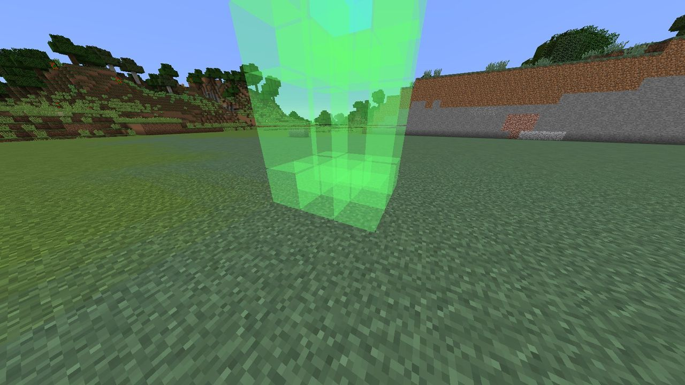
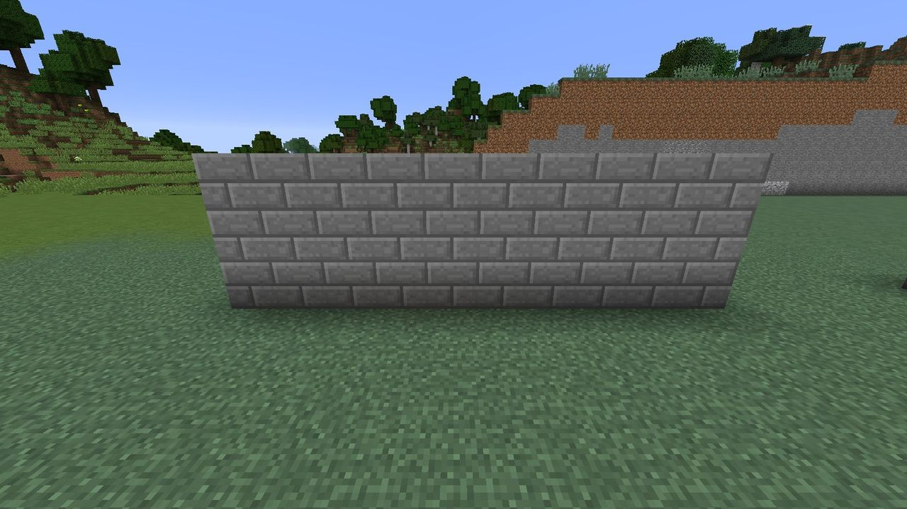

# Blueprints

{ .inline-icon align=left } A **blueprint**
(`ldtd:blueprint`) is an order form. You don't build towers by hand: you hold a blueprint, look
where it should go, and use it. The order goes to the Hearth, and its sprites build it from the
stockpile.

A blueprint is **never used up**. One Archer Tower blueprint orders as many Archer Towers as your
stockpile can pay for.

## Crafting

Every blueprint is a shapeless recipe: **a paper plus one item** that hints at what it builds.

| Blueprint | Paper + |
| --- | --- |
| Archer Tower | Bow |
| Cannon Tower | Iron ingot and gunpowder |
| Frost Tower | Snowball |
| Lantern Post | Glowstone dust |
| Guard Post | Iron sword (undamaged) |
| Stone Wall | Stone bricks |

## Ordering a build

1. **Hold the blueprint in your main hand** and look at the ground inside your territory. A
   translucent **ghost** of the structure appears where it will go.
2. **Turn to rotate it.** The structure faces the way you're facing, in quarter turns.
3. **Use the blueprint.** You'll see *Archer Tower ordered. The Hearth-sprites will build it from
   the stockpile.*



### Reading the ghost

| Colour | Meaning |
| --- | --- |
| Green | A block that will be built |
| Cyan | The tower's **core**: the block you interact with later |
| Red | Something is in the way. The order will be refused |

The ghost checks for obstacles but not for territory or cost. The order itself checks
everything.

### Why an order is refused

| Message | Fix |
| --- | --- |
| *Blueprints can only be built wholly inside a lit Hearth territory.* | Move it so every cell is inside one territory, or level up the Hearth for a bigger one. A fallen Hearth has no territory at all |
| *Something is in the way at x, y, z.* | Clear that block. Every cell of a blueprint, including the "must be air" cells inside a tower, has to be replaceable (air, grass, flowers, snow layers...) |
| *Someone is standing in the way at x, y, z.* | Step aside (or move the animal) |
| *This is &lt;owner&gt;'s territory. You can't build or break here.* | Only the owner and [trusted players](../hearth/territory.md#trusting-friends) can order builds |
| *This blueprint (...) isn't known on this server.* | The server's `blueprints.json` doesn't have it |

## Cost

A build costs **one item for every block it places**, plus an **extra cost** for some towers:
arrows for an Archer Tower's ammunition, gunpowder for a cannon. Hover over a blueprint to see
its size and full cost:

```text
Blueprint: Archer Tower
Size 3 x 3, 5 tall
Costs, from the Hearth's stockpile:
  9 Stone Bricks
  8 Oak Wood
  9 Oak Wood Planks
  4 Oak Fence
  16 Arrow
```

The materials come out of the stockpile as the sprites take them, not up front, so you can
order now and fill the stockpile later. *Sneak-use the Hearth* to see what an order is waiting
for.

| Blueprint | Footprint | Blocks | Extra cost |
| --- | :---: | --- | --- |
| Archer Tower | 3 × 3, 5 tall | 9 stone bricks, 8 oak logs, 9 oak planks, 4 oak fences | 16 arrows |
| Cannon Tower | 3 × 3, 4 tall | 19 stone bricks, 4 cobblestone walls | 4 iron ingots, 8 gunpowder |
| Frost Tower | 3 × 3, 4 tall | 9 stone bricks, 6 snow blocks, 4 glass | 16 snowballs |
| Lantern Post | 1 × 1, 4 tall | 1 stone brick, 2 oak fences | 4 glowstone dust |
| Guard Post | 3 × 3, 3 tall | 9 stone bricks, 4 oak fences, 4 stone brick slabs | 6 iron ingots, 1 iron sword |
| Stone Wall | 5 × 1, 3 tall | 15 stone bricks | - |

The tower's **core** is never charged for. It's placed by the sprites when they reach it.

## Stone Wall



Five blocks long, three high, fifteen stone bricks. Walls are the cheapest way to shape a raid.
The Gloam plan a route that **walks around** walls when it can, and **digs through** them when it
can't, so walls are for steering the Gloam into your towers' range and holding them there. See
[Routes and sieges](../gloam/sieges.md).

## Creative mode and instant building

- In **creative**, a blueprint builds the whole structure at once, for free.
- A server can set `hearth.instantBuild=true` to make survival blueprints build at once too, with
  the whole cost taken from the stockpile up front.

## Custom blueprints

Blueprints are data. A server can change any of them, or add new ones, in
`config/ldtd/blueprints.json`. See [Data files](../reference/data-files.md#blueprintsjson).
A new blueprint can be given with
`/give @p ldtd:blueprint 1 0 {blueprint:"my_tower"}`.
