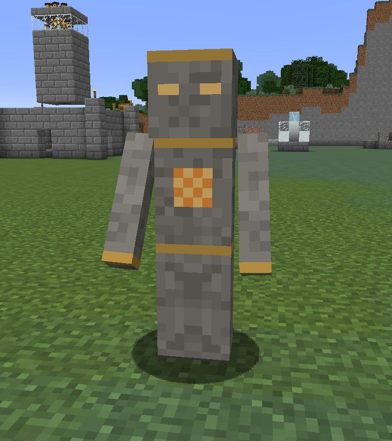
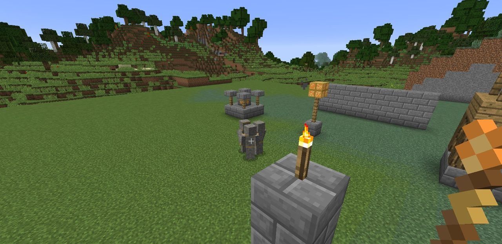

# Ember Guards

{ align=right width=280 }

**Ember Guards** (`ldtd:ember_guard`) are stone-and-ember warriors, kept by a
[Guard Post](towers.md#guard-post). They're the only defense that can stand in the Gloam's way
and fight them hand to hand, and you can tell them where to stand.

## The guards

| | |
| --- | --- |
| Health | 20 hearts (heals half a heart every 2 seconds) |
| Armour | 6 |
| Blow | The post's damage: 3 hearts at tier I, 4.05 at II, 5.1 at III |
| Reach | About 2.5 blocks |
| Fights | The nearest Gloam it can see within **its post's range of the spot it holds** (12 blocks at tier I, 13.8 at II, 15.6 at III), and anything that hurts it |

- A Guard Post keeps **three**. One comes out every 30 seconds (less at higher tiers) until it
  has them all, and fallen guards are replaced the same way.
- Players can't hurt them, and towers' arrows and shells pass through them.
- They never despawn. If their post is broken, they fade away.
- With nothing to fight, a guard walks back to the spot it holds.

## The Command Brand

{ .inline-icon align=left }
The **Command Brand** (`ldtd:command_brand`) is a smouldering baton that gives orders to the
Ember Guards within 32 blocks of you. Craft it from a Duskglass on top of two sticks:

| |
| :---: |
| Duskglass |
| Stick |
| Stick |

| Do this | Order | Message |
| --- | --- | --- |
| **Use on a block** | **Hold** the spot next to the face you clicked | *3 Ember Guards will hold that spot.* |
| **Use on a Gloam** | **Attack** that one | *3 Ember Guards are going for it.* |
| **Sneak-use** | **Follow** you | *3 Ember Guards will follow you.* |
| **Use at the air** | **Go back** to their posts | *3 Ember Guards are going back to their posts.* |

- The Brand reaches guards whose post is in a territory where **you're allowed to build**: your
  own, or one whose owner [trusts you](../hearth/territory.md#trusting-friends).
- A guard still only fights within its reach (12 to 15.6 blocks) of the spot it holds. To fight
  further out, send it there first.
- A guard following you holds wherever you are, so you can bring the squad along to a
  [Dusk Spire](../offense/dusk-spires.md).

## Using guards well

- **Plug the gap.** Send the guards to hold the gap in your wall. The Gloam have to fight through
  them, under your towers' fire.
- **Guard the Hearth.** Three guards at the Hearth stop the odd Gloam that leaks through from
  draining the Flame.
- **Escort duty.** Guards following you are a big help against a spire's night guards.
- **Mind the Dimcasters.** Guards are melee only, and Dimcasters fight from 16 blocks away.
