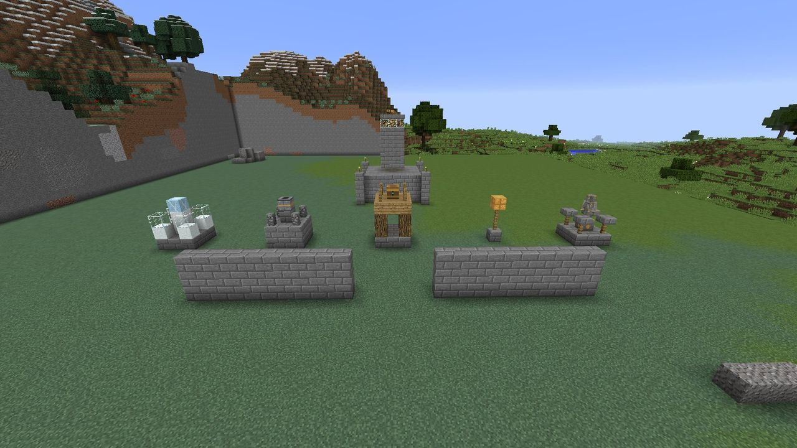

# Defenses

Everything that stands between the Gloam and your Hearth is made of **real blocks**, ordered with
a blueprint and built by your Hearth-sprites.

-   { width=32 } **[Blueprints](blueprints.md)**

    ---

    How to order a build, what the ghost preview shows, and what each blueprint costs.

-   { width=32 } **[Towers](towers.md)**

    ---

    Archer, Cannon, Frost, Lantern Post, Guard Post and Flare: what each does, its numbers at every
    tier, targeting and upgrades.

-   { width=32 } **[Ember Guards](ember-guards.md)**

    ---

    The Guard Post's squad, and how to order them about with the Command Brand.

-   :material-lightbulb-on: **[Light as a defense](light.md)**

    ---

    Why a well-lit base is worth a tier of upgrades, and how the Gloam fight back.

## At a glance

| Defense | Role | Range | Hits | Upgrades |
| --- | --- | :---: | --- | :---: |
| [Archer Tower](towers.md#archer-tower) | Steady single-target damage | 20 | One Gloam per shot | I–III |
| [Cannon Tower](towers.md#cannon-tower) | Splash | 16 | Everything within 2.5 blocks of the burst | I–III |
| [Frost Tower](towers.md#frost-tower) | Slow | 10 | **Every** Gloam in range, every pulse | I–III |
| [Lantern Post](towers.md#lantern-post) | Support | (light) | Weakens Gloam with light 15, and an aura at II and III | I–III |
| [Guard Post](towers.md#guard-post) | Blockers | 12 | Three Ember Guards in melee | I–III |
| [Flare Tower](towers.md#flare-tower) | Anti-air | 24 | One flier per shot, and lights it | I–III |
| [Stone Wall](blueprints.md#stone-wall) | Barrier | - | Steers the route, or forces a siege | - |
