# Towers

Every tower is a small structure with a **core** at its heart: a single block with the tower's
kind and tier on its texture. The core does the work, and the blocks around it are what makes it a
tower.

## How towers work

- **They need line of sight.** A tower checks for a clear line from just above its core to the
  target. Blocks you can walk through (grass, torches, flowers) don't block it.
- **They only shoot Gloam.** Arrows and shells pass straight through players, villagers,
  animals and Ember Guards.
- **They don't need the Hearth.** A tower keeps working if the Hearth falls, or even outside a
  territory.
- **They can be broken.** The Gloam can dig through a tower's blocks in a siege. If fewer than
  **three quarters** of its blocks are left, the tower stops working (*too damaged to work*)
  until they're repaired. The sprites repair siege damage from the stockpile.

## Using a tower's core

| Do this | What happens |
| --- | --- |
| **Use** | Shows the tower's kind, tier, range and what it aims at |
| **Sneak-use, empty hand** | Changes what it aims at: **first** → **strongest** → **closest** |
| **Sneak-use holding Duskglass** | Upgrades it one tier |
| **Break it** | Salvages the tower (see below) |

> *Archer tower, tier 2 - range 23 - aims at: the one furthest along. Sneak-use to change;
> sneak-use holding Duskglass to upgrade.*

### Aiming

| Setting | Aims at | Good for |
| --- | --- | --- |
| **First** (default) | The Gloam closest to reaching the Hearth | Stopping leaks |
| **Strongest** | The Gloam with the most health left | Smothers and the Eclipse |
| **Closest** | The Gloam nearest the tower | Protecting the tower itself |

### Upgrading

Every tower except the Lantern Post has **three tiers**. Sneak-use the core while holding the
Duskglass:

| | Tier I → II | Tier II → III |
| --- | :---: | :---: |
| **Cost** | 10 Duskglass | 25 Duskglass |
| **Damage** | ×1.35 | ×1.7 (of tier I) |
| **Range** | ×1.15 | ×1.3 |
| **Time between shots** | ×0.9 | ×0.8 |

Each tier changes the core's texture (brass bands for II, brass and a cyan glint for III), so you
can tell a tower's tier at a glance:

| Tower | I | II | III |
| --- | :---: | :---: | :---: |
| Archer | 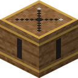{ width=48 } | 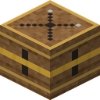{ width=48 } | 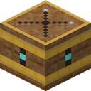{ width=48 } |
| Cannon | 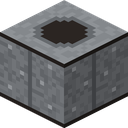{ width=48 } | 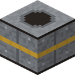{ width=48 } | 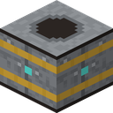{ width=48 } |
| Frost | 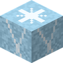{ width=48 } | 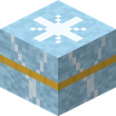{ width=48 } | 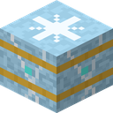{ width=48 } |
| Guard Post | 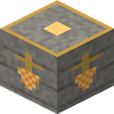{ width=48 } | 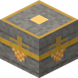{ width=48 } | 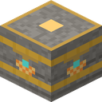{ width=48 } |

Upgrades don't change a Cannon's splash radius, a Frost Tower's slow, or the number of Ember
Guards.

### Salvaging

Break a tower's core (inside a territory where you're allowed to build) and **half** of the
tower's cost goes back into the Hearth's stockpile: half of each material, rounded down, and half
of any Duskglass spent upgrading it. The core itself drops nothing. The tower's other blocks stay
where they are, so you can mine those too.

!!! info "Anyone can aim and upgrade"

    Using, re-aiming and upgrading a tower's core aren't protected, so a friend (or a stranger)
    can spend their own Duskglass on your towers. Salvaging is protected like any other block.

---

## Archer Tower

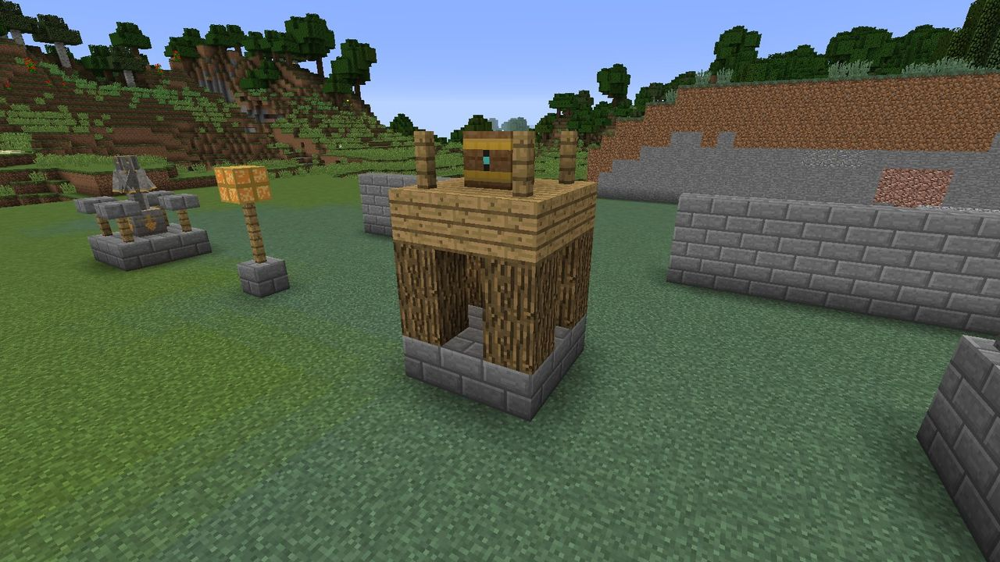

A wooden lookout on a stone base. Steady, accurate, long reach: the backbone of most defenses.

| | Tier I | Tier II | Tier III |
| --- | :---: | :---: | :---: |
| Range (blocks) | 20 | 23 | 26 |
| Damage per arrow (hearts) | 2 | 2.7 | 3.4 |
| Time between shots (s) | 1.0 | 0.9 | 0.8 |

- Fires one arrow at a time and **leads** its target, aiming where a moving Gloam is going to be.
- Arrows pass through anything that isn't Gloam, and vanish when they land. They can't be picked
  up.
- Hits fliers as well as walkers.

## Cannon Tower

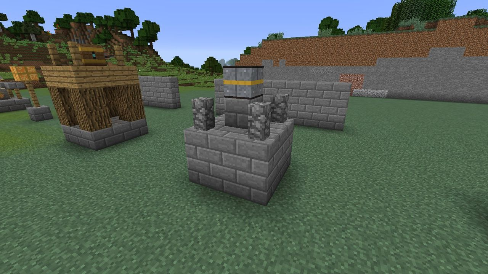

A squat stone emplacement with an iron barrel. It lobs shells that burst on impact.

| | Tier I | Tier II | Tier III |
| --- | :---: | :---: | :---: |
| Range (blocks) | 16 | 18.4 | 20.8 |
| Damage at the centre (hearts) | 4 | 5.4 | 6.8 |
| Splash radius (blocks) | 2.5 | 2.5 | 2.5 |
| Time between shots (s) | 3.0 | 2.7 | 2.4 |

- Every Gloam within 2.5 blocks of the burst takes damage: full damage at the centre, half at
  the edge.
- The shell arcs, so it can clear low walls. It bursts on the first block or Gloam it touches.
- Shells **never break blocks**.
- Best where the Gloam bunch up: at a gap in a wall, or a corner of the route.

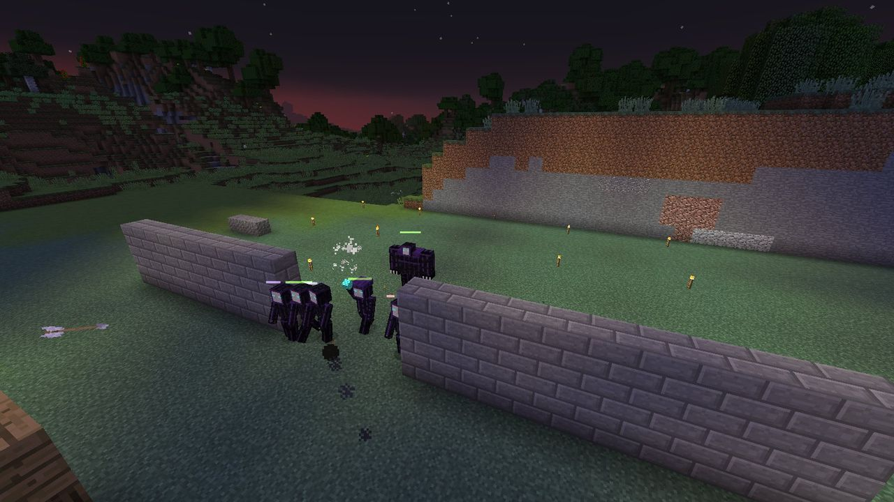

## Frost Tower

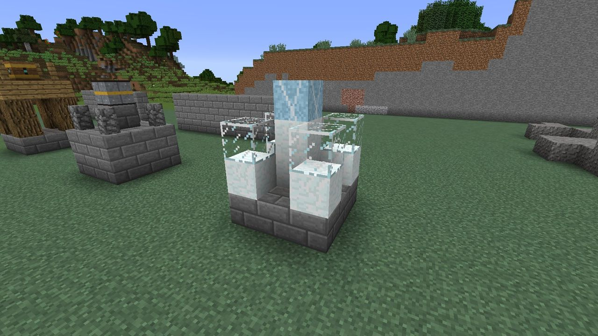

Snow and glass around a frosted core. It doesn't fire. It **pulses**, chilling everything in
reach.

| | Tier I | Tier II | Tier III |
| --- | :---: | :---: | :---: |
| Range (blocks) | 10 | 11.5 | 13 |
| Damage per pulse (hearts) | 0.5 | 0.7 | 0.85 |
| Slow | Slowness I for 3 s | Slowness I for 3 s | Slowness I for 3 s |
| Time between pulses (s) | 2.0 | 1.8 | 1.6 |

- Hits **every** Gloam in range that it can see, every pulse.
- The core glows faintly (light 6).
- Frost and light don't stack: a Gloam that's already slowed doesn't get light's slowdown as
  well. It still takes light's extra damage.

## Lantern Post

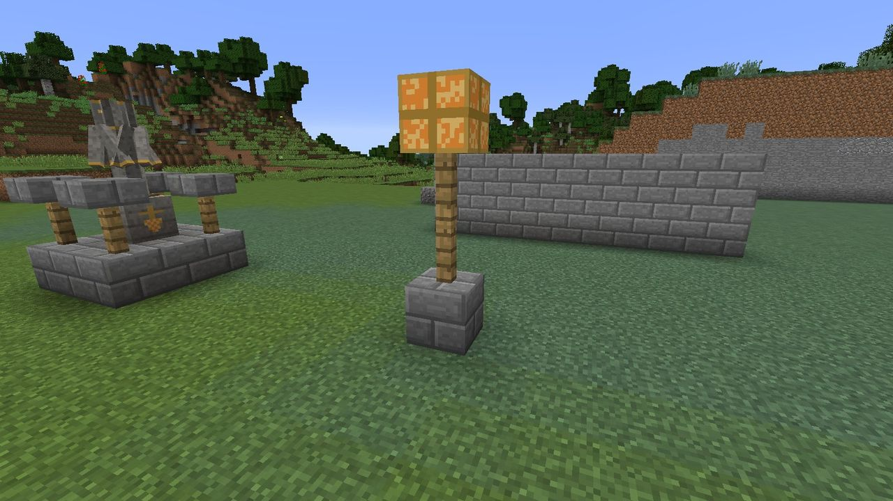

A tall fence post topped with a glowing lantern core. It doesn't attack at all: its core gives off
**light level 15**, and [light weakens the Gloam](light.md).

- The cheapest defense in the mod: a stone brick, two fences and four glowstone dust.
- It doesn't upgrade (*Lantern posts don't upgrade.*).
- Smothers can't snuff it: the core is too tough for them.
- Put them where your other towers do their killing. A lit Gloam takes **50% more damage** from
  everything.

## Guard Post

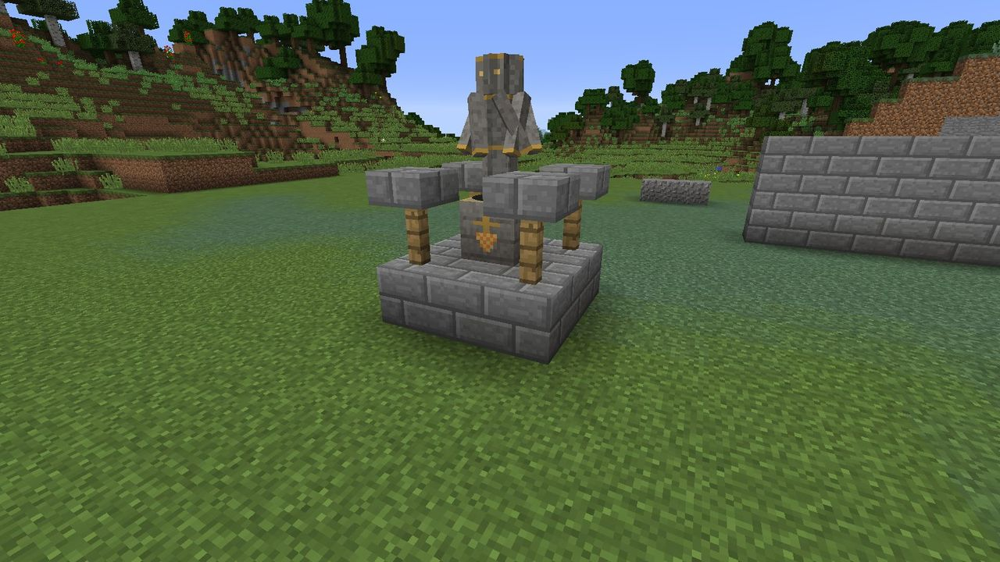

A stone platform with a fence rail and an iron-banded core. It keeps a squad of
**[Ember Guards](ember-guards.md)**, stone-and-ember warriors who fight the Gloam hand to hand.

| | Tier I | Tier II | Tier III |
| --- | :---: | :---: | :---: |
| Guards | 3 | 3 | 3 |
| Guard's blow (hearts) | 3 | 4.05 | 5.1 |
| Guards fight within (blocks of the spot they hold) | 14 | 14 | 14 |
| Time to replace a fallen guard (s) | 30 | 27 | 24 |

- The post brings out one guard at a time until it has three, and replaces any that fall.
- A broken (too damaged) Guard Post doesn't replace guards.
- See [Ember Guards](ember-guards.md) for how they fight and how to give them orders.
