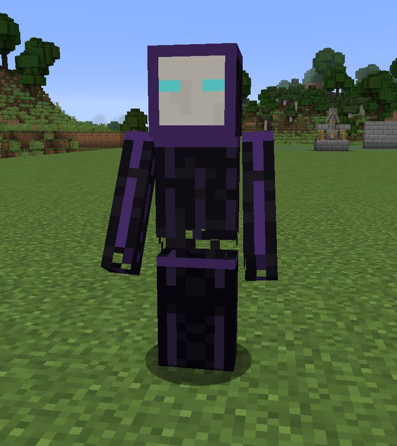
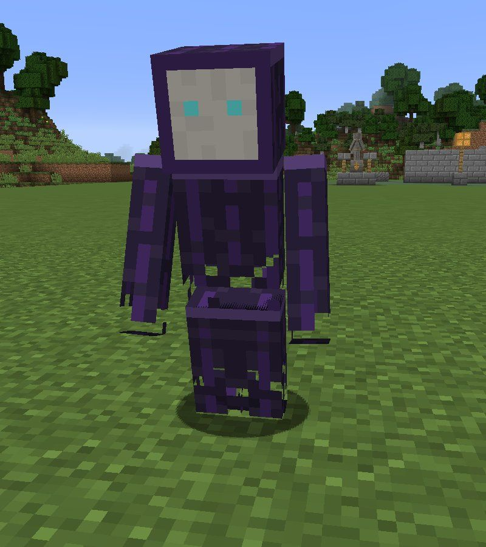
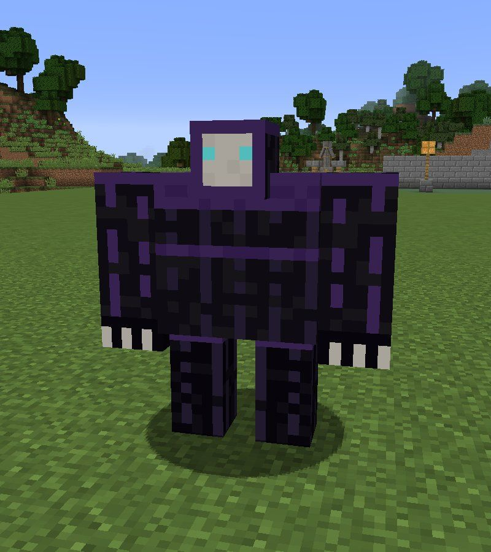
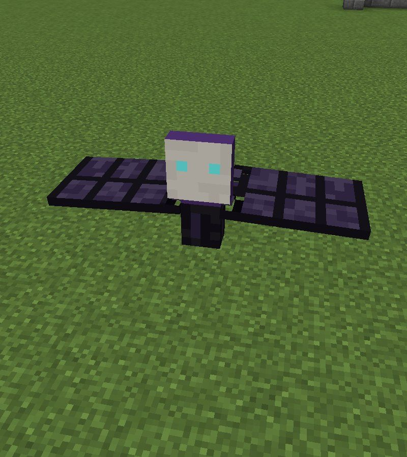
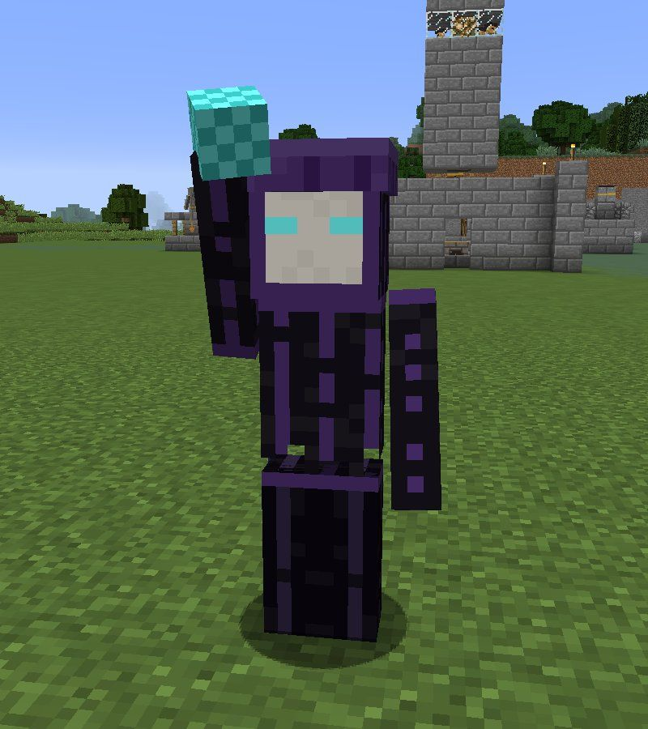
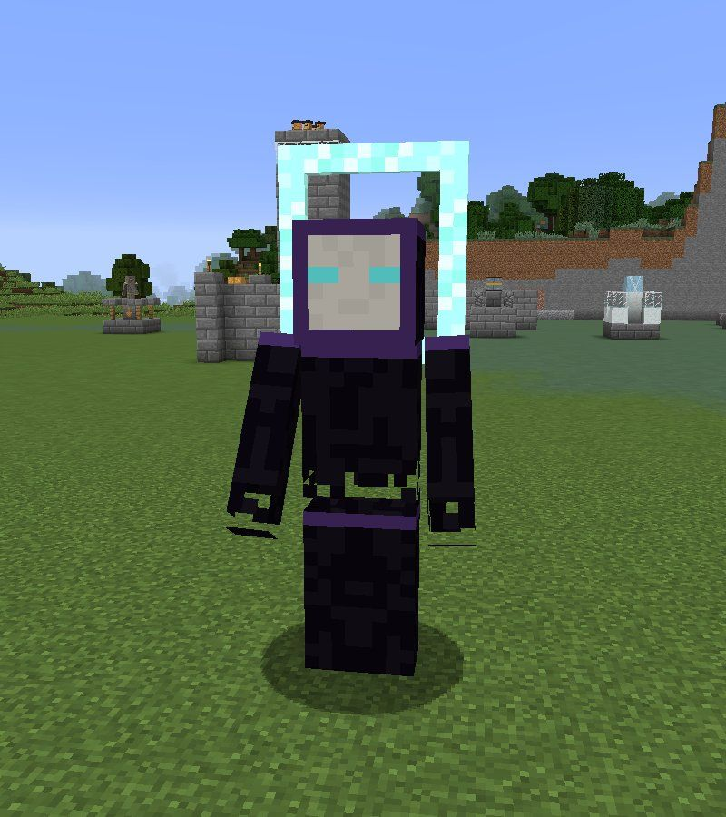

# Bestiary

All numbers are LDTD's defaults (from `config/ldtd/gloam.json` and `raid.json`). Health and
damage are in hearts. **Raids from** is the raid number from which the unit can appear in a
Hearth's raids. **Cost** is what it costs a raid's [budget](raids.md#how-big-a-raid-is). **Flame
drain** is how much Flame it takes from the Hearth every second it stands there.

Health grows with every raid survived (3% per raid, up to ×2.5), so late-game Gloam are tougher
than the table shows.

---

## Shade

{ align=right width=260 }

*The masked footsoldier.* Player-height, thin, a long ragged cloak and a flat oval mask. Most of
every raid is Shades.

| | |
| --- | --- |
| Health | 10 |
| Attack | 1.5 |
| Armour | 0 |
| Speed | Normal |
| Digs walls | Like a bare-handed player |
| Raids from | 1 |
| Budget cost | 1 |
| Flame drain | 1 |
| Duskglass | 30% chance of 1 |

**Counter:** anything. Archer Towers handle Shades well, and Cannons clear crowds of them.

---

## Flicker

{ align=right width=260 }

*The runner.* Shorter and hunched forward, trailing smoke.

| | |
| --- | --- |
| Health | 6 |
| Attack | 1 |
| Armour | 0 |
| Speed | Fast |
| Digs walls | Weakly (half a Shade) |
| Raids from | 3 |
| Budget cost | 2 |
| Flame drain | 1 |
| Duskglass | 40% chance of 1 |

**Blink:** every 4 to 7 seconds a Flicker **blinks** up to six steps ahead along its route
(about 6–8 blocks), in a puff of smoke. It never blinks past a wall it hasn't broken yet, into a
block, or while it's fighting.

**Counter:** a Flicker **can't blink while it's lit**. Light the approach, and slow it with a
Frost Tower so it spends longer in range.

---

## Smother

{ align=right width=260 }

*The siege brute.* Half again as wide as a Shade, with huge arms and a tiny mask in a broad body.

| | |
| --- | --- |
| Health | 30 |
| Attack | 3 |
| Armour | 6 |
| Speed | Slow |
| Digs walls | **6× a Shade** |
| Raids from | 3 |
| Budget cost | 5 |
| Flame drain | **4** |
| Duskglass | 2, always |

**Snuffs lights:** every two seconds a Smother puts out one light source within about 3 blocks:
torches, glowstone and other soft, bright blocks (inside a territory only; the sprites rebuild
them after the raid).

**Breaks walls:** where a route needs to go through a wall, a Smother gets through six times
faster than a Shade.

**Counter:** focused damage. Set an Archer Tower to aim at **the strongest**, and kill Smothers
before they reach the Hearth: four Flame a second is a lot.

---

## Moth-wraith

{ align=right width=260 }

*The flyer.* Wide flat wings, a small body and a two-holed mask.

| | |
| --- | --- |
| Health | 5 |
| Attack | 1 |
| Armour | 0 |
| Speed | Fast (flying) |
| Digs walls | Never |
| Raids from | 4 |
| Budget cost | 2 |
| Flame drain | 2 |
| Duskglass | 50% chance of 1 |

**Flies:** a Moth-wraith ignores the ground route and your walls entirely. It spawns in the air
and flies straight for the Hearth, cruising about 5 blocks up.

**Drawn to light:** every second it looks around, and if it finds somewhere noticeably brighter
it detours towards it. Over bright light (12+) it flutters about aimlessly.

**Charges:** when it has a target, it dives straight at it.

**Counter:** your ordinary towers hit fliers too. Use its love of light: a bright spot, covered by
Archer Towers, away from the Hearth can hold Moth-wraiths where you want them.

---

## Dimcaster

{ align=right width=260 }

*The caster.* Tall, hooded, one arm raised holding a dark orb.

| | |
| --- | --- |
| Health | 8 |
| Attack | 2 (bolt) |
| Armour | 0 |
| Speed | Normal |
| Digs walls | Weakly |
| Raids from | 3 |
| Budget cost | 3 |
| Flame drain | 1 |
| Duskglass | 50% chance of 1 |

**Darkness bolts:** every two seconds, a Dimcaster throws a **Darkness Bolt** at a player (or
anything that hurt it) within 16 blocks. A hit deals 2 hearts of magic damage and **Weakness**
for 4 seconds. Bolts pass through other Gloam and burst on blocks.

It has no melee attack. It still marches on the Hearth with the others.

**Counter:** range and cover. Your towers outrange it, and a wall between you and it blocks the
bolts.

---

## The Eclipse

{ align=right width=260 }

*The boss.* Twice the size of a Shade, with a ring-shaped halo of a mask.

| | |
| --- | --- |
| Health | **200** |
| Attack | 5 |
| Armour | 10 |
| Speed | Slow |
| Digs walls | 8× a Shade |
| Raids from | After 3 spires fall |
| Budget cost | - |
| Flame drain | **6** |
| Duskglass | **30**, always |

The Eclipse never comes from the raid budget. It joins the **last wave of every raid** on a
Hearth once three Dusk Spires near it have fallen, and keeps coming until it's destroyed. See
[The Eclipse](../offense/eclipse.md) for the whole fight.

---

## At a glance

| Unit | Health | Armour | Speed | Raids from | Cost | Drain | Special |
| --- | :---: | :---: | :---: | :---: | :---: | :---: | --- |
| Shade | 10 | 0 | Normal | 1 | 1 | 1 | - |
| Flicker | 6 | 0 | Fast | 3 | 2 | 1 | Blinks ahead |
| Smother | 30 | 6 | Slow | 3 | 5 | 4 | Snuffs lights, breaks walls |
| Moth-wraith | 5 | 0 | Fast, flies | 4 | 2 | 2 | Ignores walls, drawn to light |
| Dimcaster | 8 | 0 | Normal | 3 | 3 | 1 | Ranged bolts, Weakness |
| The Eclipse | 200 | 10 | Slow | spires | - | 6 | Boss: summons Shades, ends light's weakness |

Speeds as movement values: Shade 0.25, Flicker 0.33, Smother 0.19, Moth-wraith 0.30, Dimcaster
0.23, Eclipse 0.20 (a vanilla zombie is 0.23).
