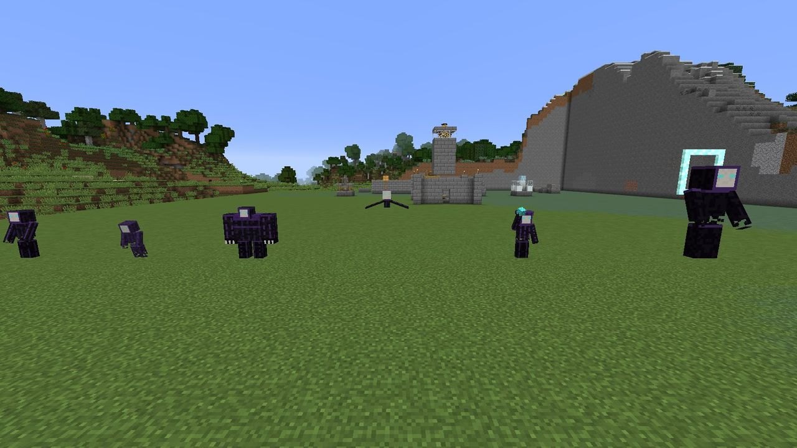

# The Gloam

!!! gloam "Who they are"

    The Gloam are what lives in the dark between settlements: shadow given shape, bone-white masks
    over smoke, with eyes that glow cyan. They hate light the way fire hates water. At night they
    come out of their **Dusk Spires** to put the Hearths out. When one is destroyed, its shadow
    hardens into **Duskglass**.

The Gloam are LDTD's enemy faction: six original units, from the common Shade to the Eclipse.
They don't spawn naturally. They come in **raids** on Hearths, and they stand guard at Dusk Spires
at night.

-   :material-skull: **[Bestiary](bestiary.md)**

    ---

    Every unit: what it does, its stats, and how to counter it.

-   :material-weather-night: **[Raids](raids.md)**

    ---

    When raids come, how big they are, how they're announced and how they end.

-   :material-wall: **[Routes and sieges](sieges.md)**

    ---

    How the Gloam find their way to the Hearth, and how they break through your walls.

## Things every Gloam has in common

- **They come for the Hearth.** A raiding Gloam marches on the Hearth along a planned route.
  Once there, it stands and drains the Flame.
- **They fight back.** Any Gloam attacks whatever hurts it, and any player within 10 blocks.
- **Light weakens them** (block light 10+: slower, and 50% more damage taken), and **daylight
  burns them**. See [Light as a defense](../defenses/light.md).
- **They drop Duskglass** when killed, unless daylight killed them.
- **They never despawn**, so a Gloam that wandered off in a raid is still out there.
- **They only break blocks inside a lit Hearth territory.** Never anywhere else.
