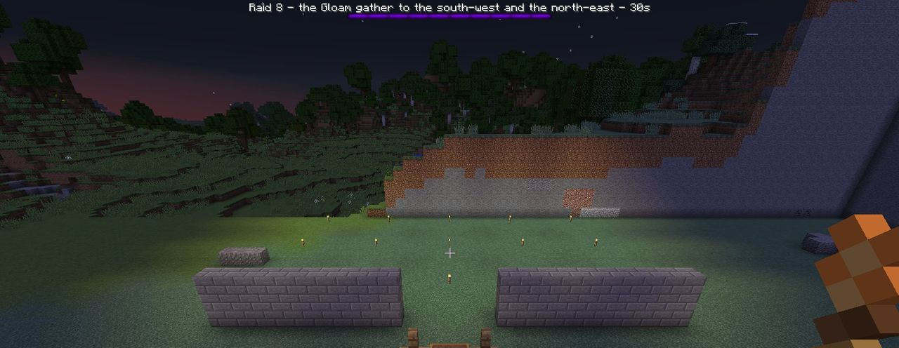
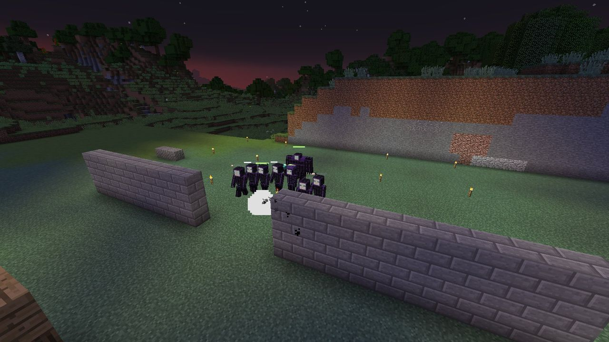

# Raids

A **raid** is one night's attack on a Hearth: an announcement, a 30-second countdown, then three
waves of Gloam marching on the Hearth.

## When raids come

### At nightfall

Once a night, when **all** of these are true, a raid starts on its own:

- it's night (from just after sunset, time 12500, to just before sunrise, 23200);
- the Hearth is lit, claimed, and not already being raided;
- the Hearth hasn't been raided yet tonight;
- the Hearth's **owner** is online, in the same dimension, not in spectator mode, and within **96
  blocks** of the Hearth.

That last rule is the important one. **Nobody comes home to a ruined base.** If you're away, the
Gloam don't come, and trusted friends don't count.

Unclaimed village Hearths are never raided.

### Calling a raid early

You can choose to fight sooner, for a bigger reward. At night, **sneak-use the Hearth with an empty
hand** to see its state, then **sneak-use it again within 5 seconds**. Only the owner can call a
raid.

A called raid:

- has a **25% bigger** budget;
- pays **25% more** Duskglass;
- counts as that night's raid, so no second one comes on its own.

You can't call a raid in daylight (*The Gloam only come in the dark.*), during a raid, or on a
cold Hearth.

## The announcement

The moment a raid starts, every player within the territory's radius plus 64 blocks hears it and
sees:

> *The Gloam gather to the south-west and the north-east. Raid 8: 19 Shade, 3 Smother, 6 Flicker,
> 4 Moth-wraith, 4 Dimcaster. They come in 30 seconds.*

- **Where:** the direction(s) they'll come from. If a [Dusk Spire](../offense/dusk-spires.md)
  stands within 384 blocks, the raid comes from that spire's side. Otherwise the direction is
  random. **From raid 5 on**, a second direction is added, at least 90° from the first.
- **What:** every unit in the raid, so you know what you're facing.
- **When:** the countdown, also shown on a purple boss bar.

## The raid

When the countdown ends, the Gloam appear **6 blocks outside your territory** on the announced
side(s), on solid ground, and march on the Hearth.

- They come in **three waves**, 40 seconds apart. Each wave is announced: *Wave 2 of 3 is
  coming.* The cheapest units come first, so Smothers and the Eclipse arrive in the last wave.
- At most **120** Gloam are alive per Hearth at once. The rest queue up and come in as others
  die.
- The boss bar shows **how many Gloam remain** (alive, queued and in waves still to come) and its
  fill is the Hearth's **Flame**.
- The Hearth-sprites hide in the Hearth for the whole raid.

## How a raid ends

| Ending | When | Result |
| --- | --- | --- |
| **The Hearth holds** | Every Gloam of every wave is dead | Raid survived. Duskglass paid |
| **Dawn** | Sunrise, with Gloam still out | Raid survived. Duskglass paid. The rest of the Gloam fade |
| **The Hearth falls** | The Flame reaches 0 | No reward. A quarter of the stockpile is lost and the Hearth goes cold. See [The Flame](../hearth/flame.md) |
| **Stopped** | The Hearth is broken, its chunk unloads, or an operator runs `/ldtd raid stop` | No reward |

In every case, Gloam left over from the raid vanish in a puff of smoke.

### The reward

A raid survived pays Duskglass straight into the Hearth's stockpile:

**Duskglass = 2 + the raid number** (×1.25 if you called it early)

So raid 1 pays 3, raid 10 pays 12 and raid 30 pays 32. That's on top of whatever the Gloam
dropped when they died.

## How big a raid is

Each raid has a **budget**. Units are bought from it one at a time, at random (weighted towards
Shades), until it runs out. Each unit costs what the [bestiary](bestiary.md) says, and no single
kind may take more than its share (Smothers, Dimcasters and Moth-wraiths at most 30% each,
Flickers 40%).

**Budget = 6 + 4 × (raids survived) + 8 × (Hearth level − 1)**

plus 25% if called early, plus **3 per tier** of every standing Dusk Spire within 384 blocks,
capped at 400.

| Raid | Level 1 | Level 2 | Level 3 | Level 4 | Level 5 | Gloam health |
| :---: | :---: | :---: | :---: | :---: | :---: | :---: |
| 1 | 6 | 14 | 22 | 30 | 38 | ×1.00 |
| 2 | 10 | 18 | 26 | 34 | 42 | ×1.03 |
| 3 | 14 | 22 | 30 | 38 | 46 | ×1.06 |
| 5 | 22 | 30 | 38 | 46 | 54 | ×1.12 |
| 10 | 42 | 50 | 58 | 66 | 74 | ×1.27 |
| 20 | 82 | 90 | 98 | 106 | 114 | ×1.57 |
| 30 | 122 | 130 | 138 | 146 | 154 | ×1.87 |
| 50 | 202 | 210 | 218 | 226 | 234 | ×2.47 |

(Before spire bonuses.) "Raid" here is the Hearth's own raid number, raids survived plus one. A
fallen raid doesn't count, so losing doesn't make the next raid bigger.

Which units can appear grows too:

| From raid | New units |
| :---: | --- |
| 1 | Shade |
| 3 | Flicker, Smother, Dimcaster |
| 4 | Moth-wraith |
| (3 spires razed) | The Eclipse, in every raid |

## Admin tools

Operators can start and stop raids at will: `/ldtd raid start` (`/ldtd raid start called` for a
called raid) and `/ldtd raid stop`, while standing in a territory. A started raid ignores the
night and the defender rule. See [Commands](../reference/commands.md).

Every number on this page lives in `config/ldtd/raid.json`. See
[Data files](../reference/data-files.md#raidjson).
