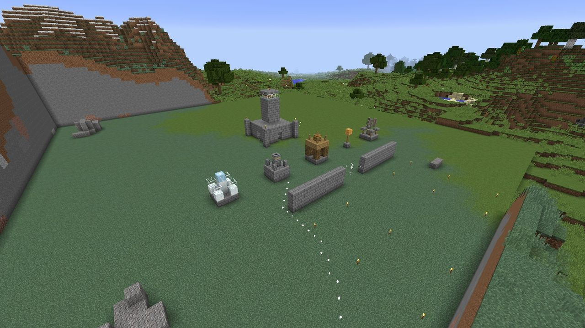

# Routes and sieges

The Gloam don't wander towards your Hearth. Each raid plans a **route** from where it gathers to
the Hearth, and walks it. When your walls leave no way through, the route goes **through** them,
and the Gloam break the wall down.

## How a route is planned

The route planner treats the territory as a grid of columns and finds the cheapest path to
within two blocks of the Hearth:

- **Walking** costs 1 per block (a little more on the diagonal). A Gloam can step up 1 block and
  drop down 3.
- **Breaking a block** costs `1 + hardness × 4`. So breaking one stone brick (hardness 1.5) costs
  as much as walking 7 blocks, and obsidian (hardness 50) as much as walking 201.
- It never cuts corners diagonally, never walks on water or lava, and only digs through walls
  (two blocks high) where the ground is too high to climb.

So the Gloam **walk around** your walls whenever the detour is shorter than the cost of
breaking through, and **break in** where it isn't. Raising the hardness of a wall makes them more
willing to walk the long way round.

The planner only looks at loaded chunks within the territory (plus 16 blocks), and gives up after
60,000 steps. If it can't find any route, the Gloam head straight for the Hearth.

Routes are shared and cached: Gloam starting from about the same place follow the same route, and
it's replanned when they get stuck.

## Sieges

When a Gloam reaches a block its route goes through, it stops and **hits it**, once a second.

- Every block has **10 hit points per point of hardness** (at least 10). Stone brick has 15,
  obsidian 500.
- Each hit does the unit's **dig power**: 1 for a Shade, 0.5 for Flickers and Dimcasters, 6 for
  a Smother, 8 for the Eclipse. Moth-wraiths never dig.
- Damage from several Gloam adds up, and shows as the familiar block-cracking animation.
- A cracked block heals if nobody hits it for 30 seconds.
- A broken block **drops as an item** (so you can pick it up and rebuild), and goes on the
  Hearth's **repair list**. The sprites put it back from the stockpile after the raid.

The Gloam also re-plan if they get stuck, and Flickers never blink past a wall that's still
standing.

## What the Gloam can never break

- **Anything outside a lit Hearth territory.** This is LDTD's one absolute rule: every way the
  Gloam damage blocks goes through the territory check. The countryside, your neighbour's base and
  an unclaimed wilderness are never touched.
- **The Hearth itself.**
- **Unbreakable blocks** (bedrock, barriers and the like).

Inside a territory, though, **everything else** is fair game, tower blocks and tower cores
included. A Smother that reaches a tower can take it apart.

## Seeing a route

Operators can run `/ldtd route show` standing anywhere. It plans a fresh route from there to the
nearest Hearth and draws it for 10 seconds: white sparkles along the path, and purple ones on
every block the Gloam would break.

> *Route: 53 steps, 16 blocks to break, cost 175.2. Showing it for 10 seconds.*

It's the best way to test a wall layout before a raid finds the hole in it.

## Turning sieges off

A server can set `griefing.gloamDamageBlocks=false` in `config/ldtd.cfg`. The Gloam then never
break anything, and a fully walled-in Hearth can't be reached. See
[Configuration](../reference/configuration.md#griefing).
