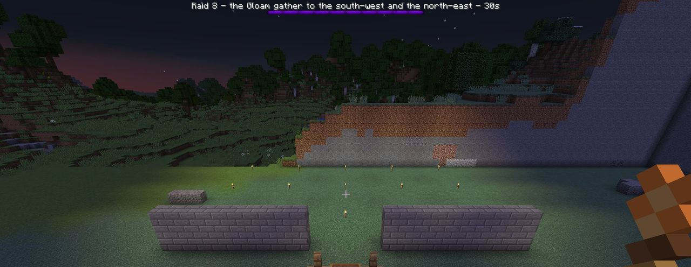
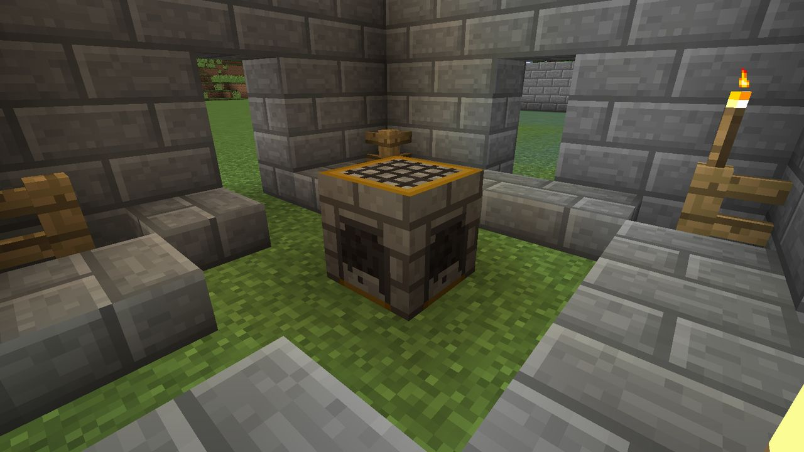

# The Flame, falling and relighting

## The Flame

Every Hearth has a **Flame**, from 0 to 100. It's LDTD's version of a tower-defense game's
"lives". During a raid, the boss bar shows it.

Once the raid's countdown ends, every second the Hearth loses Flame for **each Gloam standing at
it** (within about 3 blocks):

| Unit | Flame lost per second |
| --- | :---: |
| Shade | 1 |
| Flicker | 1 |
| Dimcaster | 1 |
| Moth-wraith | 2 |
| Smother | 4 |
| The Eclipse | 6 |

So a single Shade left alone at the Hearth puts it out in under two minutes, and four Smothers do
it in six seconds. Kill what reaches the Hearth first.

Between raids, the Flame refills at **5 per minute** (from empty to full in 20 minutes). It
doesn't refill during a raid.

## When the Hearth falls

If the Flame reaches 0, the Hearth **falls**:

- The raid ends at once. The remaining Gloam vanish in smoke.
- **A quarter of every stack** in the stockpile is lost (rounded to the nearest item).
- The Hearth goes **cold**: its fire goes out, its texture turns to grey ash, and it gives off no
  light. A cold Hearth claims no territory: no protection, no blueprints, no raids and no border.
  Its sprites huddle over it and do nothing.
- There's no Duskglass for the raid.

> *The Hearth of Steve has fallen. Its fire is out.*

**Nothing else is lost.** Your towers keep standing (and keep shooting), your walls stay, your
level and your count of raids survived are kept.

## Relighting

**Use the cold Hearth while holding 8 coal.** It burns again with half its Flame, and everything
comes back: the territory, protection, sprites and raids. In creative mode it's free.

> *The Hearth burns again.*

Anyone can relight a cold Hearth, not only its owner, so a friend can bring it back while you're
away.

The fuel and the amount can be changed with `hearth.relightFuel` and `hearth.relightFuelCount`,
and the loss with `hearth.fallStockpileLoss`. See [Configuration](../reference/configuration.md#hearth).
