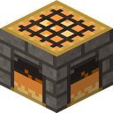
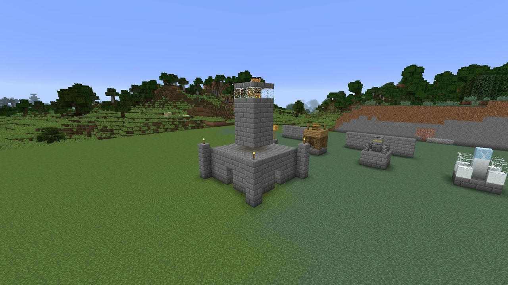

# The Hearth

{ .inline-icon align=left } The **Hearth**
(`ldtd:hearth`) is the heart of LDTD. It claims a territory, holds the stockpile your defenses are
built from, keeps the Hearth-sprites that build them, and is what the Gloam come to put out.

## Crafting

| | | |
| :---: | :---: | :---: |
| | Fire charge | |
| Gold ingot | Furnace | Gold ingot |
| Stone bricks | Stone bricks | Stone bricks |

## Placing

A Hearth can go anywhere, in any dimension, with one rule: **Hearths need room**. A new Hearth
is refused if another Hearth (lit or fallen) is within **136 blocks**, centre to centre. That's
twice the largest territory radius (64) plus a 4-block gap on each side, so two fully grown
territories never overlap. If you're too close, the message names the other Hearth's owner and
its position.

There's no limit on how many Hearths one player can own.

Placing the Hearth claims it for you at **level 1**: a territory with a 24-block radius. The
sprites start on its first growth stage as soon as the stockpile has the materials.

## Using the Hearth

| Do this | What happens |
| --- | --- |
| **Use** (right-click) | Opens the 27-slot stockpile. See [Stockpile and Hearth-sprites](sprites.md) |
| **Use while holding Duskglass** | Raises the Hearth one level, if you have the Duskglass in hand and the materials in the stockpile. See [Levels and growth](levels.md) |
| **Sneak-use, empty hand** | Shows its state: owner, level, territory radius, Flame and raids survived, plus what the sprites are working on |
| **Sneak-use again within 5 seconds** | Owner only, at night: **calls the next raid early**, for a bigger raid and a bigger reward. See [Raids](../gloam/raids.md#calling-a-raid-early) |
| **Sneak-use an unclaimed Hearth** | Claims it. See [Villages](../offense/villages.md) |
| **Use a cold Hearth while holding 8 coal** | Relights it. See [The Flame](flame.md) |

The stockpile, leveling and the guards' orders are open to the owner and to players they
[trust](territory.md#trusting-friends). Calling a raid is for the owner only.

## Breaking a Hearth

By default only the Hearth's owner (and operators) can break it. Anyone else can't make a dent.
Breaking it:

- drops the block and **everything in the stockpile**;
- ends any raid on it;
- releases the territory, so protection ends and the sprites fade away;
- cancels any builds still queued.

Towers, walls and buildings stay where they are.

While it burns, the Hearth gives off light level 15. A [fallen](flame.md) Hearth turns cold and dark
until relit.

The Hearth is otherwise very tough: hardness 5, blast resistance 6000, and immune to withers, the
Ender Dragon and **the Gloam**. A siege can break everything around it, but never the Hearth
itself.

## In this section

- [Levels and growth](levels.md): what each level costs and gives, and the hall the sprites build.
- [Stockpile and Hearth-sprites](sprites.md): how building and repairs work.
- [Territory and protection](territory.md): the border, what's protected, and trusting friends.
- [The Flame, falling and relighting](flame.md): what happens when the Gloam reach the Hearth.
