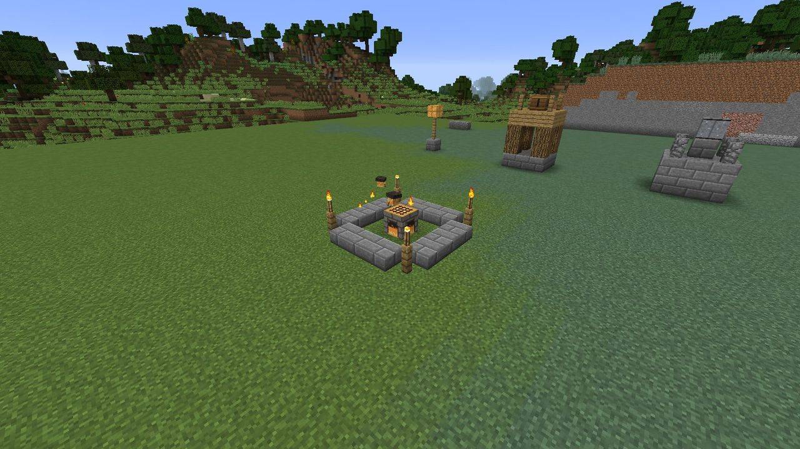
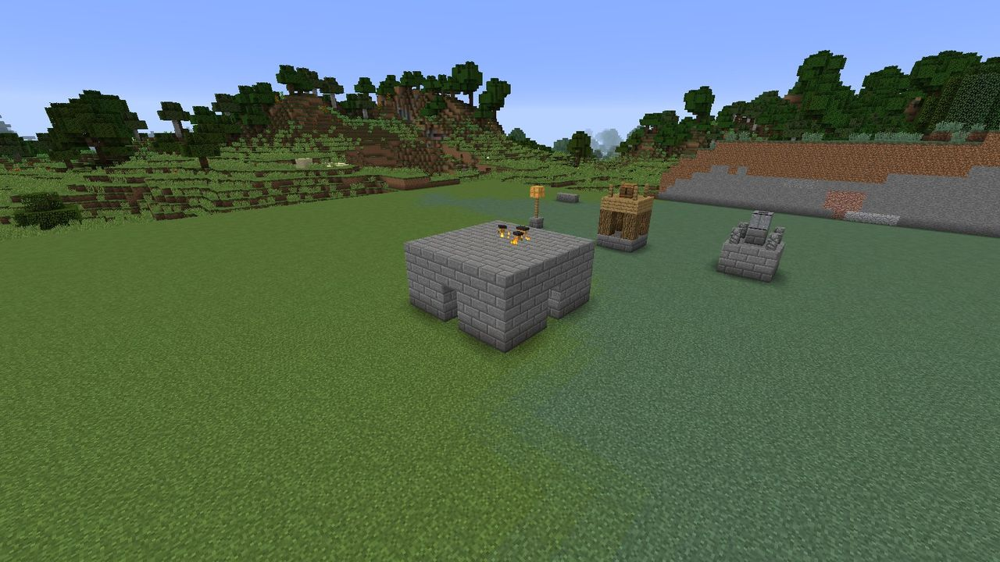
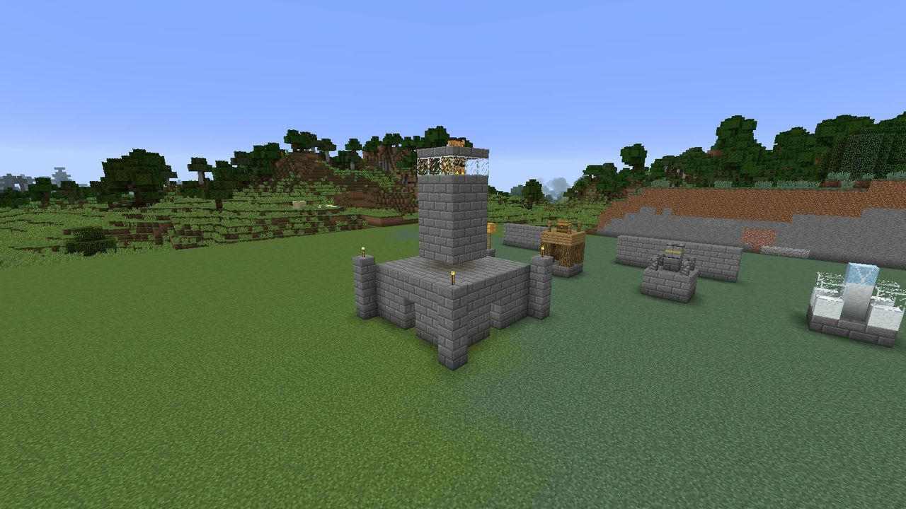

# Levels and growth

A Hearth grows through **five levels**. Each one widens its territory, lets it keep more
Hearth-sprites, and at levels 1, 3 and 5 the sprites build a bigger structure around it.

## The levels

| Level | Territory radius | Sprites | Cost: Duskglass (in hand) | Cost: materials (from the stockpile) |
| :---: | :---: | :---: | :---: | --- |
| 1 | 24 | 2 | - | - (placing the Hearth) |
| 2 | 32 | 3 | 8 | 32 stone bricks |
| 3 | 40 | 4 | 20 | 64 stone bricks, 64 stone brick slabs |
| 4 | 48 | 6 | 40 | 32 iron ingots |
| 5 | 64 | 8 | 80 | 64 stone bricks, 16 glass, 4 glowstone |

To level up, **use the Hearth while holding the Duskglass**. The Duskglass comes out of your hand
and the materials out of the stockpile. If anything is short, nothing is taken, and you're told
everything that's missing:

> *To reach level 3 the Hearth needs: 12 Duskglass, 64 Stone Brick Slab (Duskglass in hand, the
> rest in the stockpile).*

Leveling up plays a fanfare and a burst of flame. The territory grows at once.

The owner and [trusted players](territory.md#trusting-friends) can level up a Hearth. In creative
mode it's free.

!!! warning "Higher levels mean bigger raids"

    Each level adds **8 points** to every raid's budget. That's the same as two raids survived.
    It's still almost always worth it: see [Raids](../gloam/raids.md#how-big-a-raid-is).

## Growth stages

At levels 1, 3 and 5 the Hearth queues a **growth stage**, a structure its sprites build around
it from the stockpile like any other order. Levels 2 and 4 don't add a stage.

=== "Level 1: the brazier ring"

    A 5 × 5 ring of stone brick slabs, with a fence post and torch at each corner.

    **Materials:** 12 stone brick slabs, 4 fences, 4 torches.

    

=== "Level 3: the hall"

    A 7 × 7 stone brick hall over the Hearth, three blocks tall with a doorway on each side, and a
    slab roof.

    **Materials:** 64 stone bricks and 49 stone brick slabs.

    

=== "Level 5: the beacon tower"

    A 9 × 9 frame of corner pillars and a tall stone brick chimney over the hall, topped with a
    glass-and-glowstone lantern. The tallest thing in your territory, and a landmark you can see
    from far off.

    **Materials:** 56 stone bricks, 8 glass, 1 glowstone, 4 torches and 9 stone brick slabs.

    

Builders never break anything. If one of a stage's cells is already taken by something solid,
it's skipped. To get the full structure, keep the ground around the Hearth clear: the level-5
tower needs a 9 × 9 area and 11 blocks of height.

!!! tip "Claimed a village Hearth?"

    A [village Hearth](../offense/villages.md) keeps its level when you claim it, and every growth
    stage up to that level is queued. Hearth Squares leave room for all of them.

## Territory never shrinks

A level's radius can only be the same or larger than the level before it. `/ldtd hearth
setlevel` can lower a Hearth's level (operators only), but no growth stages are removed.
