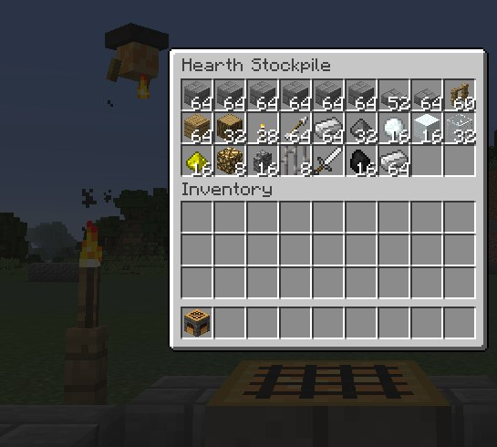
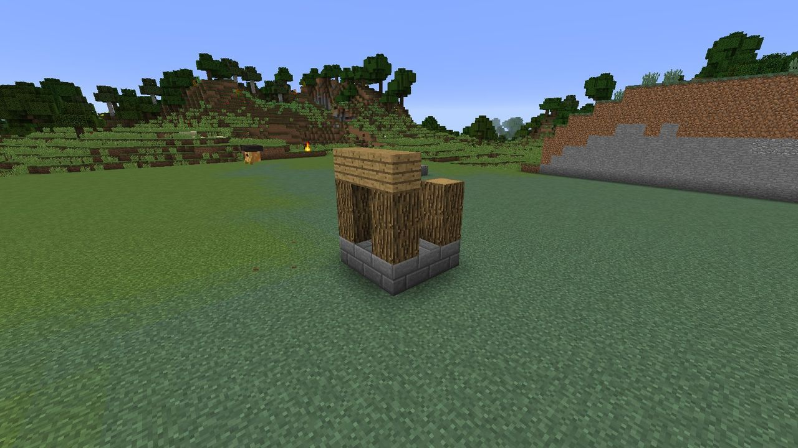

# Stockpile and Hearth-sprites

## The stockpile

Every Hearth holds a **27-slot stockpile**, opened by using the Hearth. It's the only place your
builders take materials from: tower and wall blueprints, the Hearth's growth stages, level-ups
(the materials part) and siege repairs are all paid out of it. Raid rewards are paid into it.

- The owner and [trusted players](territory.md#trusting-friends) can open it. With protection
  on (the default), nobody else can.
- You can use it from up to 8 blocks away, like a chest.
- **Hoppers and pipes work.** The stockpile is exposed on every side of the Hearth, so you can
  feed it from a quarry, a farm or a sorting system.
- If the Hearth is broken, everything in the stockpile drops.
- If the Hearth falls in a raid, every stack loses a quarter of its items (rounded).

## Hearth-sprites

**Hearth-sprites** (`ldtd:hearth_sprite`) are small floating ember-spirits with a soot cap and
little tongs. They do all the building.

- A Hearth keeps as many sprites as its level allows: **2** at level 1, then 3, 4, 6 and **8** at
  level 5.
- A new sprite appears over the Hearth every **10 seconds** until it has its full number.
- Sprites fly, ignore gravity and can't be hurt (only `/kill` and the void remove them). They
  never despawn.
- They glow and trail embers, so you can always find them.
- If their Hearth is broken they fade away.

### How they build

1. A sprite flies back to the Hearth and takes up to **four blocks' worth of work** from the
   queue, paying for each block from the stockpile as it takes it.
2. It flies to each spot and places the block, with a little puff of flame.
3. Back to the Hearth for the next load.

There's no fixed build speed: more sprites (a higher level) build faster, and so does a tower
that's close to the Hearth. A sprite that gets stuck for ten seconds teleports to where it's
going.

**Builders never break anything.** If a blueprint cell is already taken by something solid when
the sprite gets there, the cell is skipped and the block goes back to the stockpile. Cells marked
as "must be air" only clear replaceable things like grass and flowers.

### What they work on first

1. **Repairs** come first, oldest first.
2. Then **orders** (blueprints and growth stages), oldest first.

An order that can't be paid for yet doesn't hold up the ones behind it. A blueprint's extra cost
(arrows for an Archer Tower, gunpowder and iron for a Cannon Tower) is paid in full before its
first block is placed.

To see what the sprites are doing, **sneak-use the Hearth with an empty hand**:

> *Builders: 3 jobs and 12 repairs to go, waiting for 8 Arrow in the stockpile.*

### Repairs

When the Gloam break a block during a siege, or a Smother snuffs a torch, the block is put on the
Hearth's **repair list**. The sprites put back exactly what was there, paid from the stockpile
(one of the block's item each).

Only damage done *by the Gloam* inside a lit territory is repaired. Blocks you break yourself
aren't.

!!! tip "Keep repair stock"

    A bad siege can break dozens of stone bricks. If the stockpile runs out, the repairs wait and
    new orders go ahead. Keep a stack of your wall material in reserve.

### When they hide

Sprites stop work and huddle over the Hearth when:

- a **raid** is on;
- **any Gloam** comes within 24 blocks of the Hearth, raid or not;
- the Hearth has **fallen**.

Blocks they were carrying (already paid for) aren't lost. They finish placing them when they go
back to work.

## Instant building

A server can set `hearth.instantBuild=true` in `config/ldtd.cfg`. Survival blueprints then build
at once, with the whole cost taken from the stockpile up front, instead of being ordered.

In **creative mode**, blueprints always build at once and for free.
