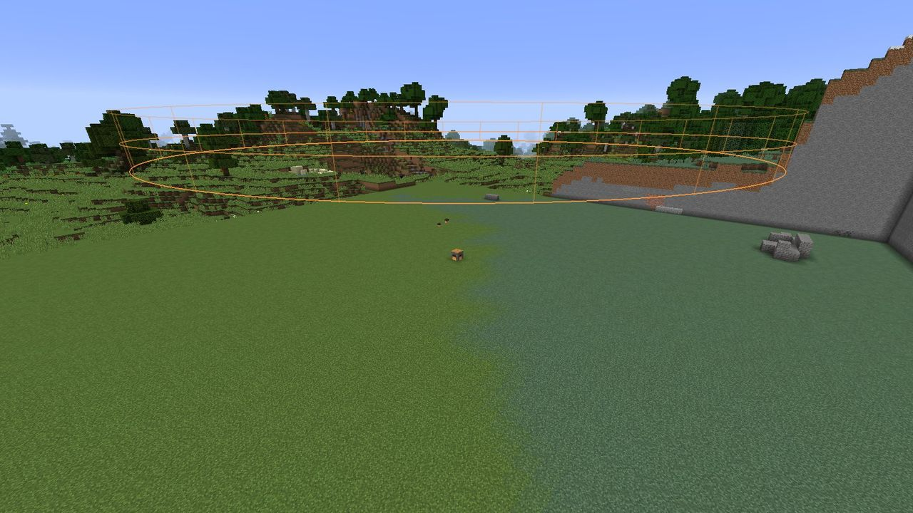

# Territory and protection

A Hearth's **territory** is the circle of land around it. Its radius is set by the Hearth's
[level](levels.md): 24 blocks at level 1, up to 64 at level 5. It's a full column, from bedrock
to the sky.

Inside a territory:

- **Towers and walls can be built.** A blueprint is refused unless the whole structure fits
  inside one lit territory.
- **The Gloam can break blocks.** Outside every territory they can't, ever.
- **Untrusted players can't build** (by default).

A territory only counts while its Hearth is **lit**. A fallen Hearth claims nothing until it's
relit.

## Seeing the border

- **While you hold a Hearth**, every territory within about 48 blocks of its edge is drawn as an
  ember-coloured fence: three rings at your feet, at waist height and above your head, with a post
  every few blocks. It follows your height, so it's always where you can see it.
- **Near the edge**, a few ember sparks drift up along the border wherever you are, without
  holding anything.
- **Crossing the border** shows a message above the hotbar: *Entering the territory of
  &lt;owner&gt;'s Hearth*, *Entering an unclaimed Hearth's territory* or *Leaving the territory*.

You can change when the fence is drawn in the client config: `client.showTerritoryBorders` is
`holding` (default), `always` or `never`. The sparks are `client.edgeParticles`.

## Protection

LDTD protects a claimed territory from other players, lightly. With the defaults, a player who
isn't the owner or trusted **can't**, inside the territory:

- break or place blocks;
- empty buckets;
- use flint and steel or fire charges;
- open the stockpile.

And **explosions** (creepers, TNT, ...) break no blocks inside a claimed territory. They still hurt
players and mobs.

Operators ignore protection by default (`protection.opsBypass`).

**What protection doesn't do:**

- It never affects the Gloam. Their sieges follow their own rule: inside a lit territory only.
- It doesn't stop players from fighting, opening doors, using chests other than the stockpile, or
  using tower cores (looking, changing a tower's aim and upgrading it are open to anyone).
- **Unclaimed** village territories aren't protected. Anyone can build there until someone claims
  the Hearth.

Each part can be switched off in `config/ldtd.cfg`. See [Configuration](../reference/configuration.md#protection).

## Trusting friends

Stand in your territory and use:

| Command | What it does |
| --- | --- |
| `/hearth trust <player>` | Lets them build, use the stockpile, level the Hearth, order blueprints and command your Ember Guards |
| `/hearth untrust <player>` | Takes it away |
| `/hearth trusted` | Lists who's trusted (anyone in the territory can see the list) |

The player must have joined the server at least once. Only the owner (or an operator) can change
the list.

Trust is per Hearth. If you own two Hearths, trust your friend at each.

## Hearths need room

A new Hearth must be at least **136 blocks** from any other, centre to centre, so that two
level-5 territories never overlap (two 64-block radii and a 4-block gap each side). Change the
gap with `hearth.territorySpacing`.
