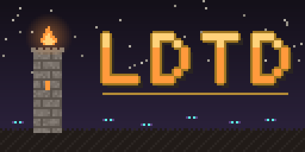
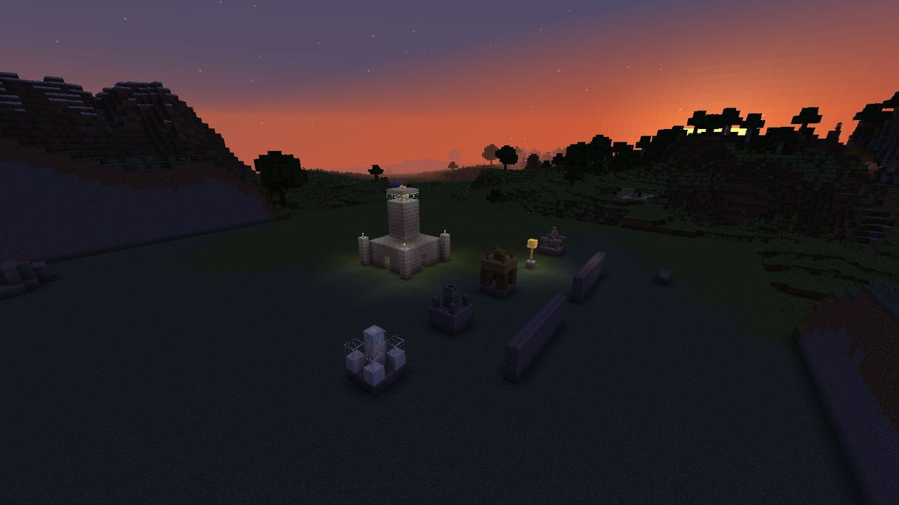
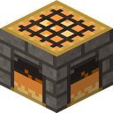
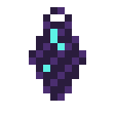
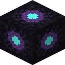
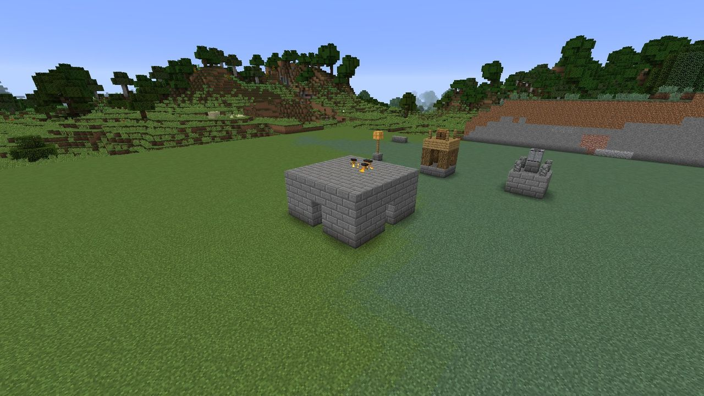
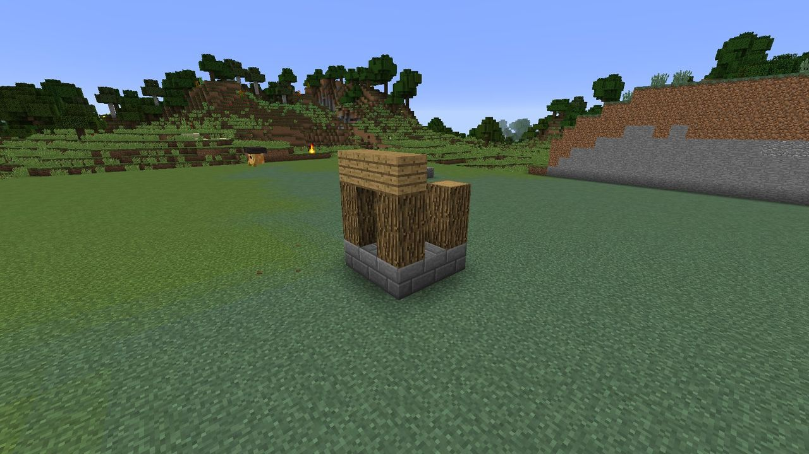
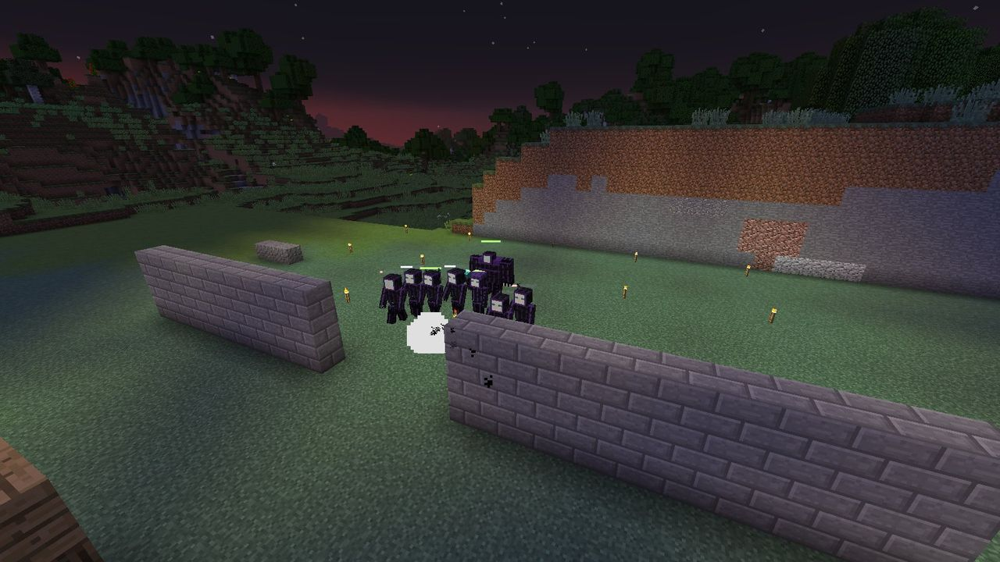
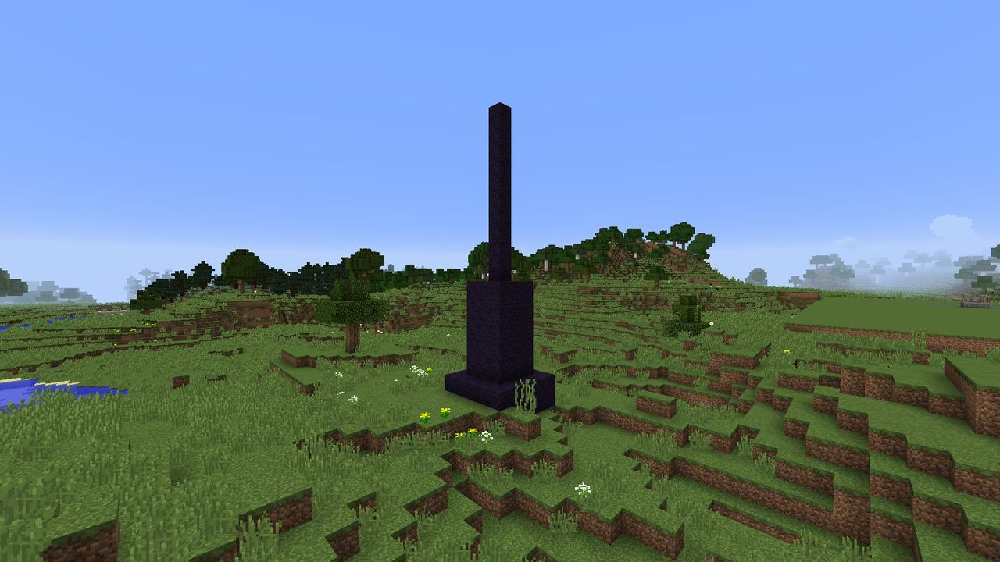

---
hide:
  - navigation
  - toc
---

# LDTD: Limitless Development: Tower Defense

{ width=512 }

Survival tower defense for Minecraft 1.12.2 (Forge)

Claim your base, or a village, with a **Hearth**. Hearth-sprites build towers and walls from your
blueprints, block by block, with materials from the Hearth's stockpile. When night falls, the
**Gloam** come for your flame. Hold the line, grow your Hearth, then take the fight to the Dusk
Spires that send them, and face the Eclipse.

[:material-download: Download](https://github.com/Mica-Technologies/LDTD/releases){ .md-button .md-button--primary }
[:material-rocket-launch: Your first night](start/first-night.md){ .md-button }

## Everything in one loop

-   { width=40 } **Claim land with a Hearth**

    ---

    A Hearth claims the land around it and holds a stockpile. It grows through five levels, and
    its sprites raise a bigger hall around it as it does.

    [:octicons-arrow-right-24: The Hearth](hearth/index.md)

-   { width=40 } **Build from blueprints**

    ---

    Hold a blueprint to see a ghost of the build, use it, and the Hearth-sprites build it from the
    stockpile. Five towers with three tiers each, and walls.

    [:octicons-arrow-right-24: Defenses](defenses/index.md)

-   { width=40 } **Hold the night**

    ---

    When you're near, the Gloam gather at your border and march on your Hearth's flame. They route
    around your walls, and break through when they must, but only inside a territory.

    [:octicons-arrow-right-24: The Gloam](gloam/index.md)

-   { width=40 } **Strike back**

    ---

    Dusk Spires rise in the wilds and feed the raids. Raze them, and the Eclipse comes for you.

    [:octicons-arrow-right-24: Strike back](offense/index.md)

## A look around

## Features

- **Hearths** claim a territory, hold a stockpile, keep Hearth-sprites and grow through five
  levels. Villages may have an unclaimed Hearth in a **Hearth Square**, ready to be taken up.
- **Five towers, three tiers each:** [Archer](defenses/towers.md#archer-tower) (steady shots),
  [Cannon](defenses/towers.md#cannon-tower) (splash), [Frost](defenses/towers.md#frost-tower)
  (slows everything in reach), [Lantern](defenses/towers.md#lantern-post) (light that weakens the
  Gloam) and [Guard Post](defenses/towers.md#guard-post) (Ember Guards you command). Walls too.
  Every tower is real blocks the Gloam have to get through.
- **The Gloam:** an original night faction of six units, from the common
  [Shade](gloam/bestiary.md#shade) to the light-snuffing [Smother](gloam/bestiary.md#smother),
  the blinking [Flicker](gloam/bestiary.md#flicker), the flying
  [Moth-wraith](gloam/bestiary.md#moth-wraith), the ranged [Dimcaster](gloam/bestiary.md#dimcaster)
  and [the Eclipse](offense/eclipse.md).
- **Raids that route and siege:** the Gloam plan a path to the Hearth around your walls, and break
  through when walls block the way, only ever inside a territory.
- **Raids that scale** with every night survived and every level gained, checked by an
  [offline simulator](contributing/balance-simulator.md) in the test suite.
- **Territory protection** against players the owner hasn't trusted.
- **Data-driven:** every balance number is [JSON](reference/data-files.md), reloadable in game, and
  never fatal when broken.
- **An in-game guide book**, tooltips, health bars and raid sound cues.

!!! hearth "New here?"

    Start with **[How LDTD plays](start/how-it-plays.md)** for the big picture, then follow
    **[Your first night](start/first-night.md)** step by step. *The Hearthkeeper's Guide*, which
    every player gets on first join, covers the essentials in game.

## Contributing to this wiki

Every page is a Markdown file under
[`docs/`](https://github.com/Mica-Technologies/LDTD/tree/main/docs) in the mod's repository, so a
correction is an ordinary pull request, and the site rebuilds itself when it's merged. The
:material-pencil: icon at the top of each page opens it on GitHub.

---

<small>LDTD is MIT-licensed. All of its textures, models and text are original, and are listed in
the [asset provenance ledger](ASSET_PROVENANCE.md). Its sounds are Minecraft's own, played at
runtime. **NOT AN OFFICIAL MINECRAFT PRODUCT. NOT APPROVED BY OR ASSOCIATED WITH MOJANG OR
MICROSOFT.**</small>
