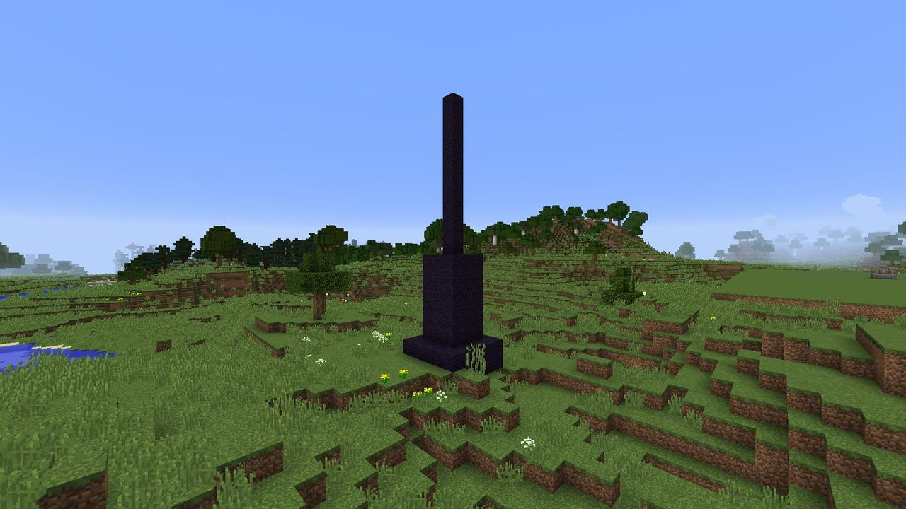
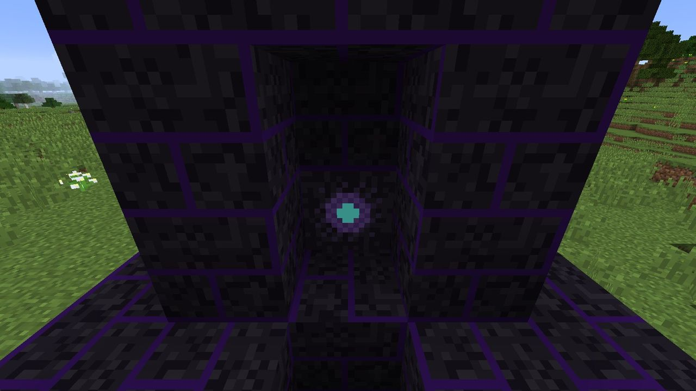
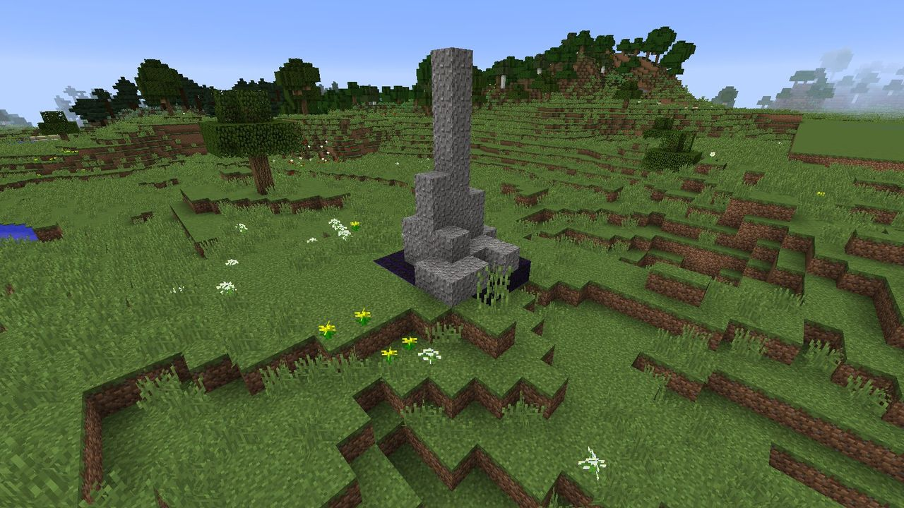

# Dusk Spires

**Dusk Spires** are the Gloam's outposts: black needles of **Dusk Stone** rising from the wilds,
each with a **Spire Core** sealed in its base. A standing spire makes the raids on every Hearth
near it **bigger**, and decides **which way they come from**. Razing spires is how you go on the
offensive, and how you call out [the Eclipse](eclipse.md).

## Where they are

Spires generate in **new overworld chunks**:

- about one chunk in 300 gets one,
- never within **256 blocks** of the world spawn,
- never within **384 blocks** of another spire,
- never inside a Hearth's territory, and never on water.

The further from spawn, the bigger they are:

| Tier | Distance from spawn | Needle height | Total height | Night guards | Duskglass when razed |
| :---: | --- | :---: | :---: | :---: | :---: |
| 1 | under 600 blocks | 5 | 12 | 2 | 5 |
| 2 | 600 to 1200 blocks | 8 | 15 | 3 | 10 |
| 3 | 1200+ blocks | 11 | 18 | 4 | 15 |

A spire is a 5 × 5 plinth, a 3 × 3 shaft six blocks tall, and a one-block needle on top. You can
spot one from a long way off.

## What a spire does

- **Bigger raids:** every standing spire within **384 blocks** of a Hearth adds **3 × its tier**
  to that Hearth's raid budget. Three tier-3 spires nearby add 27, as much as seven raids
  survived.
- **Aimed raids:** if any spire stands within 384 blocks, the raids come from the side of the
  **nearest** one. You know where to build your defenses, and where to go hunting.
- **Darkness:** no Gloam within **32 blocks** of a standing spire counts as lit, however bright it
  is: torches, Lantern auras and flares don't weaken them there. The spire's night guards fight at
  full strength.

## Night guards

At night, a spire is guarded. When a player (not in creative or spectator) comes within 32
blocks, Gloam rise around the core until there are **1 + tier** of them: Shades, and at tier 2 and
up, a Dimcaster in three. They don't march anywhere. They fight whoever comes, and burn away at
dawn.

By day, a spire is unguarded.

## Razing a spire

The core sits in the middle of the shaft, one block above the ground, walled in by Dusk Stone.

1. **Dig in.** Dusk Stone takes a stone pickaxe or better (hardness 3, about like cobblestone).
2. **Break the core.** It's very hard (hardness 25) and needs an **iron pickaxe** or better. Use
   Efficiency if you have it.
3. The spire **crumbles**: every Dusk Stone block around it turns to gravel or vanishes, and the
   core drops **5 Duskglass per tier**.

> *A tier 3 Dusk Spire has fallen. (Counted for the Hearth of Steve.)*

The fall is **counted for the nearest Hearth** to the spire (whoever owns it, as long as its
chunk is loaded). Once a Hearth has had **three** spires counted, [the Eclipse](eclipse.md) joins
every raid on it.

!!! tip "Go by day"

    By day there are no guards, and the Gloam burn in the sun. Go then, bring an iron pickaxe,
    and the spire is yours.

## Operators

- `/ldtd spire list` lists every standing spire in the dimension, with tier and core position.
- `/ldtd spire place [tier]` raises a spire on the ground where you stand (tier 1–3, or by
  distance from spawn if left out). It skips the spacing rules.
- Spires can be turned off, and their rarity, spacing, influence and the Eclipse threshold
  changed, under `spires` in [`config/ldtd.cfg`](../reference/configuration.md#spires).
