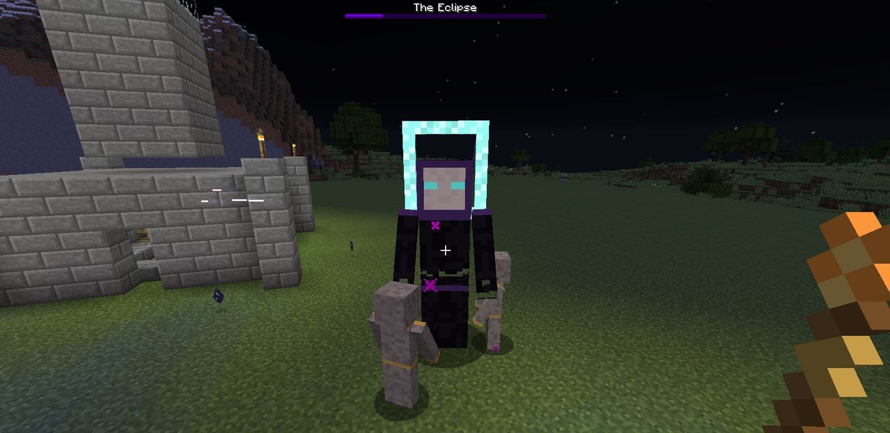

# The Eclipse

!!! gloam "The Eclipse"

    Twice the size of a Shade, wrapped in a cloak of darkness, with a ring-shaped halo where a
    mask should be. While it lives, the light itself seems to give up.

The **Eclipse** (`ldtd:gloam_eclipse`) is the Gloam's boss, and the end of LDTD's offensive
path.

## When it comes

The Eclipse never comes from a raid's budget. Once **three Dusk Spires** have been razed and
counted for your Hearth (see [Dusk Spires](dusk-spires.md#razing-a-spire)), the Eclipse joins the
**last wave of every raid** on that Hearth, until you destroy it. Raze spires, and you're calling
it out.

## What it does

| Health | Attack | Armour | Speed | Flame drain | Drops |
| :---: | :---: | :---: | :---: | :---: | :---: |
| 200 hearts | 5 hearts | 10 | Slow | 6 per second | 30 Duskglass, 100 XP |

- **It ends light's protection.** While the Eclipse lives, **no Gloam marching on your Hearth
  counts as lit**, however bright your base is. It isn't weakened by light itself, and doesn't
  burn in daylight.
- **It calls Shades.** Every 15 seconds it summons two Shades at its side (unless six or more
  are already near it), and they march on the Hearth with it.
- **It marches and breaks walls** like any Gloam, at eight times a Shade's dig power.
- **It can't be knocked back**, and fire doesn't hurt it.
- A purple **boss bar** shows its health to everyone near it.

## Beating it

- **Focus fire.** Set your best towers to aim at **the strongest**, and the Eclipse will draw all
  of them.
- **Hold it at the walls.** Its Flame drain is 6 a second: an Eclipse that reaches the Hearth
  puts out a full Flame in 17 seconds.
- **Bring your guards.** A squad of [Ember Guards](../defenses/ember-guards.md) holding the gap
  keeps it busy while the towers work.
- **Don't count on light.** Your lit kill zones stop working while it lives. Plan your damage
  without the bonus.
- **Kill the summoned Shades** before they slip past to the Hearth.

When it falls:

> *The Eclipse is destroyed. Light returns to the land.*

Your Hearth is marked as having beaten it, and it won't come again. Raids carry on, but the boss
is done.
