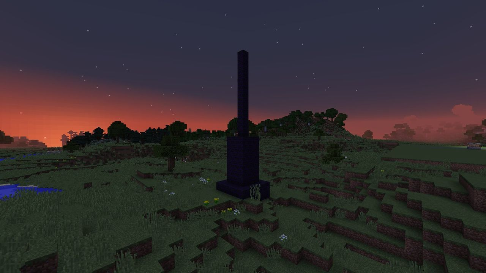

# Strike back

Holding the line is half of LDTD. The other half is taking the fight to the Gloam.

-   { width=32 } **[Dusk Spires](dusk-spires.md)**

    ---

    The black towers that feed and aim the raids. Find them, dig in and break the core.

-   :material-moon-waning-crescent: **[The Eclipse](eclipse.md)**

    ---

    The boss that comes once three spires near your Hearth have fallen.

-   :material-home-group: **[Villages](villages.md)**

    ---

    Hearth Squares with an unclaimed Hearth, and the Watch Posts that guard them.

