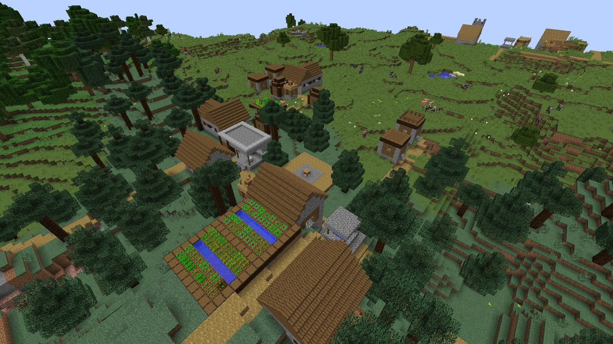
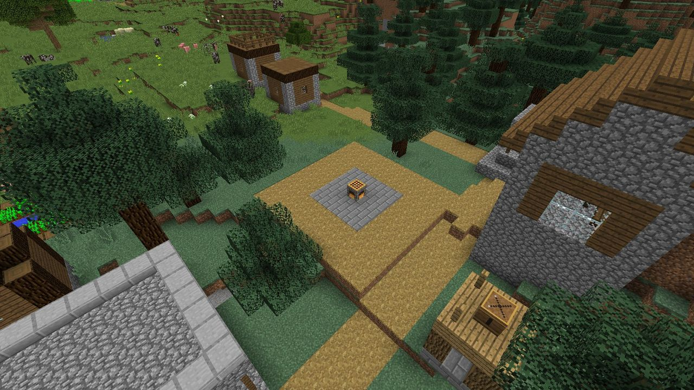

# Villages

Villages that generate after LDTD is installed may come with two new buildings.

## Hearth Square

An 11 × 11 plaza of path blocks with a stone brick centre, and an **unclaimed Hearth** in the
middle. It's laid out with clear ground all around, so the Hearth has room for every
[growth stage](../hearth/levels.md#growth-stages). A village has at most one.

**To claim it, sneak-use the Hearth with an empty hand.**

> *You take up this Hearth. It is yours to keep lit.*

The Hearth becomes yours, with the village inside your territory: your sprites start on its
growth stage, protection switches on, and raids start coming. Villagers are what you're
protecting.

Until somebody claims it, a village Hearth:

- has a territory (so the Gloam's siege rules apply there), but **no protection**: anyone can
  build;
- is never raided, and has no sprites;
- can be leveled up or broken by anyone.

!!! tip "A head start"

    A village Hearth is a free Hearth, already placed, with a Watch Post or two nearby. If you
    find one early, it's a great place to start.

## Watch Post

A village's ready-built **Archer Tower** on a cobblestone foundation, at tier I. A village can
have up to two. They're ordinary Archer Towers: they shoot Gloam, can be upgraded with Duskglass,
and can be salvaged.

## Turning them off

Set `hearth.villageBuildings=false` in `config/ldtd.cfg` (needs a restart). Villages that already
generated keep their buildings.
