# Items and blocks

Everything LDTD adds is in the **LDTD: Tower Defense** creative tab.

## Blocks

| | Name | Registry name | What it is |
| :---: | --- | --- | --- |
| 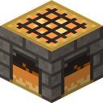{ width=48 } | **Hearth** | `ldtd:hearth` | Claims a territory, holds the stockpile, keeps the sprites. Light 15. Hardness 5, blast resistance 6000, stone pickaxe. Immune to the Gloam, withers and the dragon. [More](../hearth/index.md) |
| 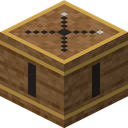{ width=48 } | **Tower Core** | `ldtd:tower_core` | The heart of every tower, placed by the sprites when they build a tower blueprint. Its texture shows the tower's kind and tier. Hardness 3.5. Drops nothing (break it to [salvage](../defenses/towers.md#salvaging)). Lantern cores give light 15, Frost cores 6. [More](../defenses/towers.md) |
| 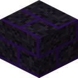{ width=48 } | **Dusk Stone** | `ldtd:dusk_stone` | The violet-veined black stone of the Dusk Spires. Hardness 3, stone pickaxe |
| { width=48 } | **Spire Core** | `ldtd:spire_core` | A Dusk Spire's heart. Hardness 25, **iron pickaxe**. Breaking it razes the spire and drops Duskglass. Drops nothing itself. [More](../offense/dusk-spires.md) |

## Items

| | Name | Registry name | What it is |
| :---: | --- | --- | --- |
| 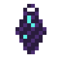{ width=48 } | **Duskglass** | `ldtd:duskglass` | The raid currency. Dropped by the Gloam, paid out for raids survived and razed spires. Raises the Hearth's level and upgrades towers. [More](#duskglass) |
| { width=48 } | **Blueprint** | `ldtd:blueprint` | An order for a structure. One item, many kinds (`{blueprint:"archer_tower"}` and so on). Never used up. [More](../defenses/blueprints.md) |
| { width=48 } | **Command Brand** | `ldtd:command_brand` | Gives orders to Ember Guards within 32 blocks. [More](../defenses/ember-guards.md#the-command-brand) |
| | **The Hearthkeeper's Guide** | (a written book) | The in-game guide, given on first join and by `/hearth guide`. [More](#the-hearthkeepers-guide) |

### Duskglass

Violet-black glass with a cyan glint: what's left when a Gloam's shadow hardens.

| Where it comes from | How much |
| --- | --- |
| Gloam drops | Shade 30% for 1, Flicker 40% for 1, Moth-wraith and Dimcaster 50% for 1, Smother 2, the Eclipse 30. Looting adds up to one more per level. Nothing if daylight killed it |
| Raids survived | 2 + the raid number, into the stockpile (×1.25 if called early) |
| Razed Dusk Spires | 5 per tier |
| Salvaged towers | Half of the Duskglass spent upgrading them |

| What it's for | How much |
| --- | --- |
| Hearth levels 2 / 3 / 4 / 5 | 8 / 20 / 40 / 80 (plus materials) |
| Tower tier II / III | 10 / 25 |
| Command Brand | 1 |

### The Hearthkeeper's Guide

A ten-page book with the essentials, given to every player the first time they join (turn off
with `hearth.giveGuide`). `/hearth guide` gives another copy.

<div class="grid" markdown>

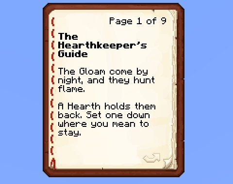

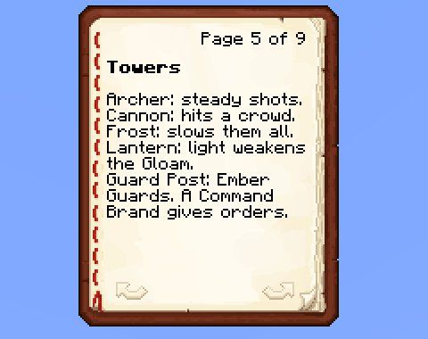

</div>

Pages: The Hearthkeeper's Guide · Your Hearth · Stockpile & Sprites · Blueprints · Towers · Raids ·
Duskglass · Dusk Spires · Neighbours · Learn More (a link that opens this wiki).

## Creatures

| | Name | Registry name | Spawn egg |
| :---: | --- | --- | :---: |
| 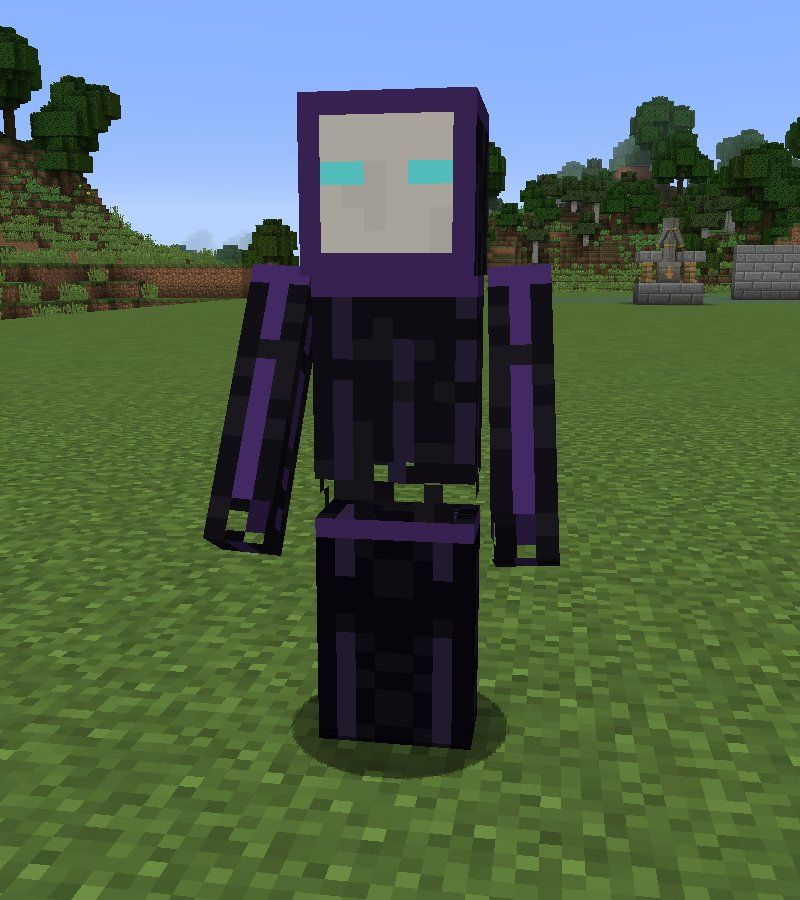{ width=80 } | Shade | `ldtd:gloam_shade` | Yes |
| 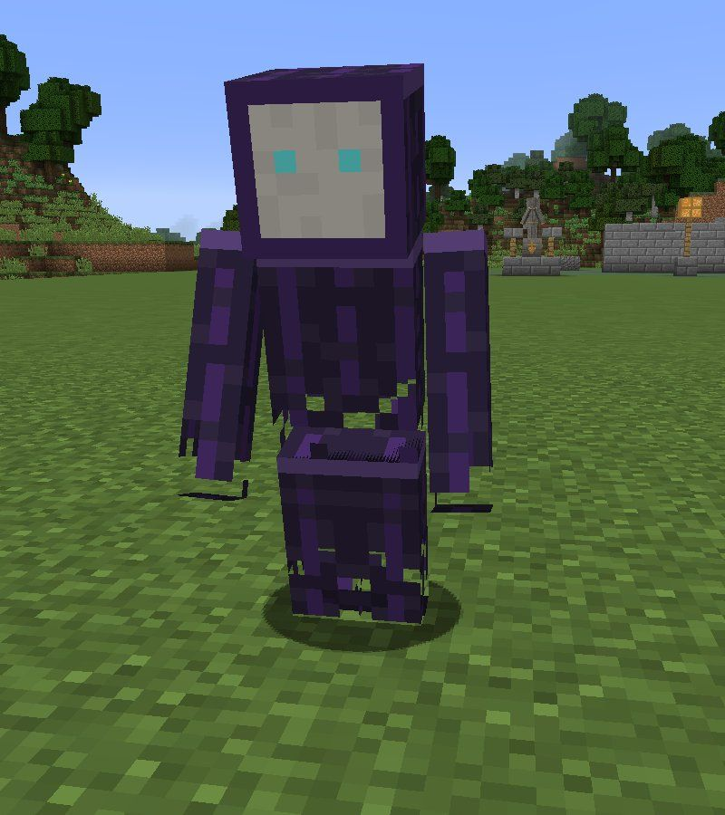{ width=80 } | Flicker | `ldtd:gloam_flicker` | Yes |
| 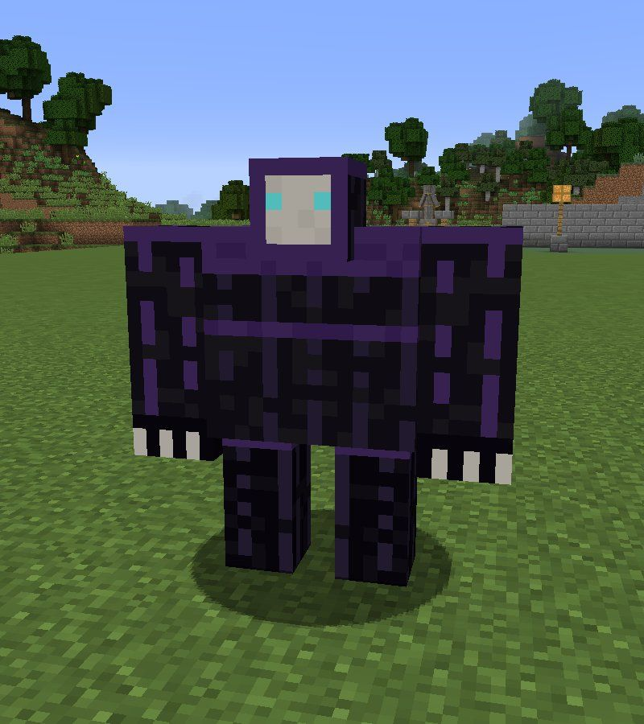{ width=80 } | Smother | `ldtd:gloam_smother` | Yes |
| 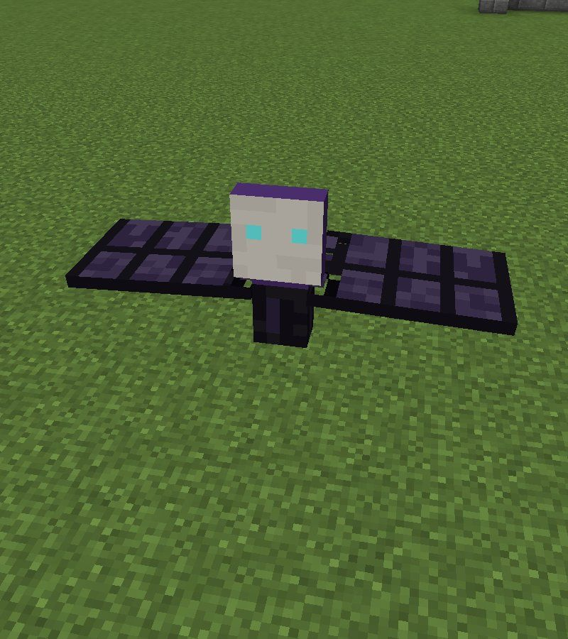{ width=80 } | Moth-wraith | `ldtd:gloam_moth_wraith` | Yes |
| 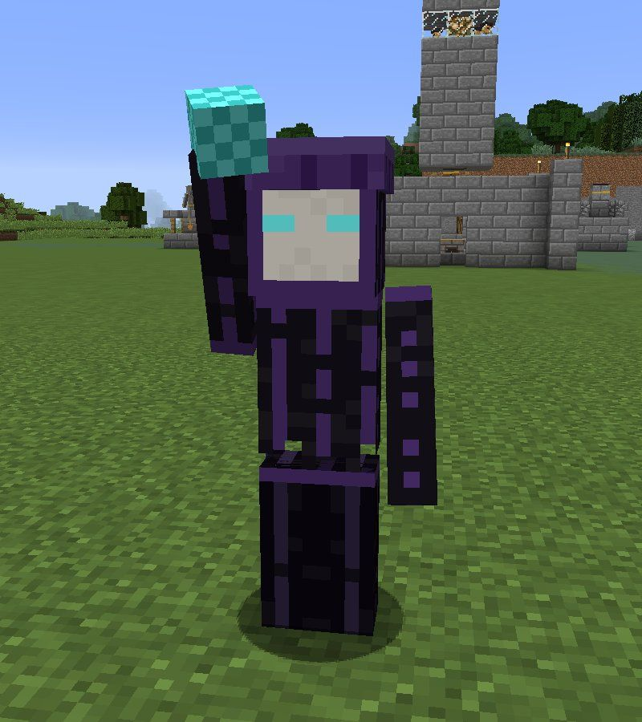{ width=80 } | Dimcaster | `ldtd:gloam_dimcaster` | Yes |
| 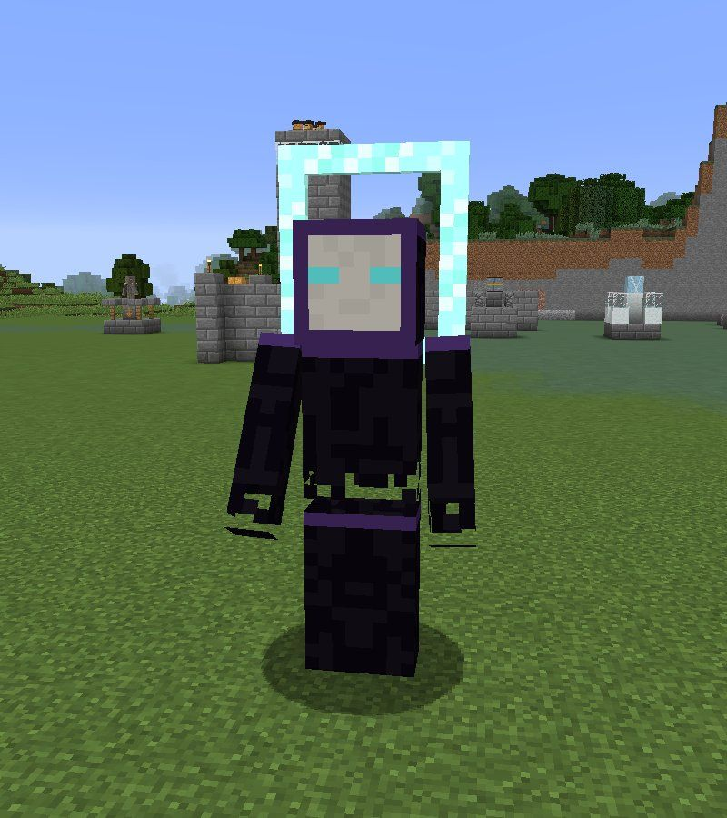{ width=80 } | The Eclipse | `ldtd:gloam_eclipse` | Yes |
| 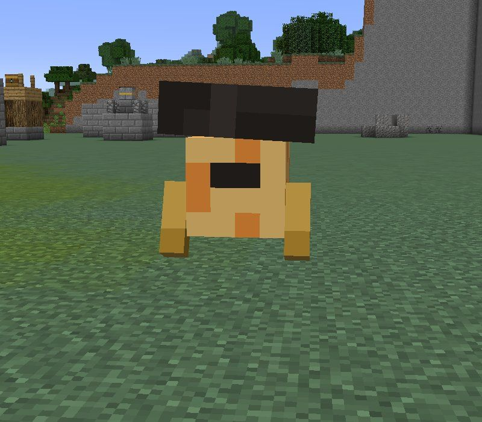{ width=80 } | Hearth-sprite | `ldtd:hearth_sprite` | No |
| 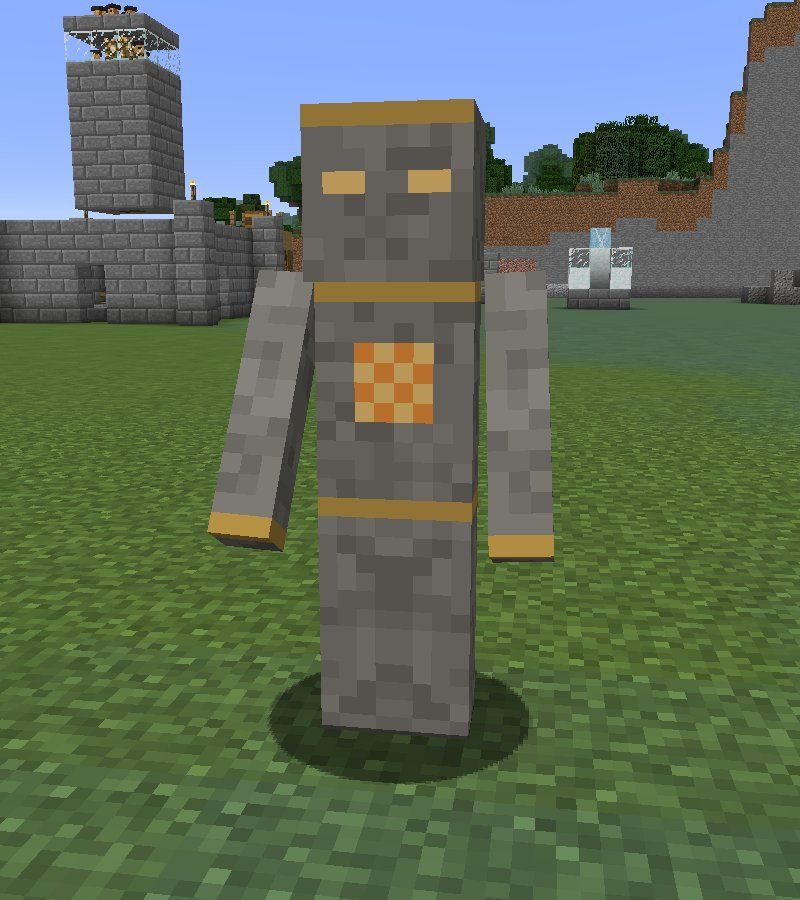{ width=80 } | Ember Guard | `ldtd:ember_guard` | No |

Projectiles: `ldtd:tower_arrow`, `ldtd:cannon_shell` and `ldtd:dark_bolt` (the Dimcaster's
Darkness Bolt).

Gloam spawned from an egg (or `/summon`) aren't part of a raid. They march on the nearest Hearth
if there is one.

## Tooltips

Every LDTD item has a short help line in its tooltip. Hold ++shift++ for the rest. For example,
the Hearth:

```text
Hearth
Claims the land around it. Raids come for it at night.
Use: open the stockpile the Hearth-sprites build from.
Sneak-use, empty hand: its state; again to call a raid early.
Use with Duskglass: raise its level.
```
