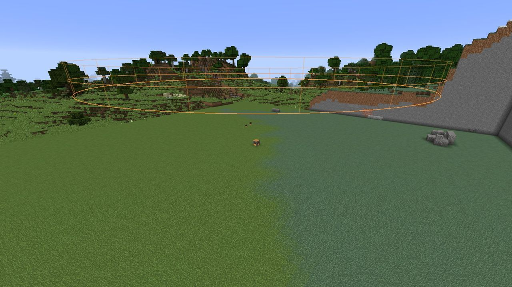
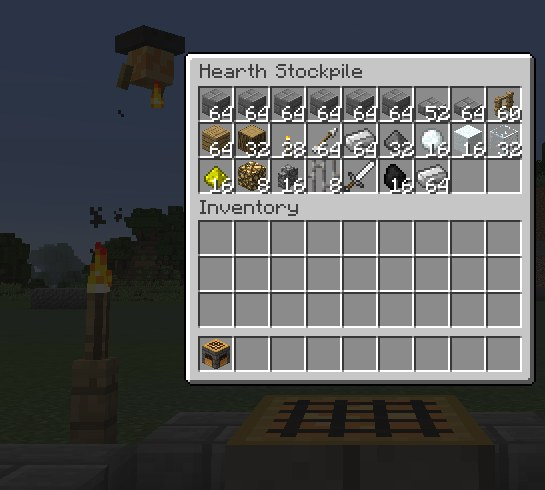
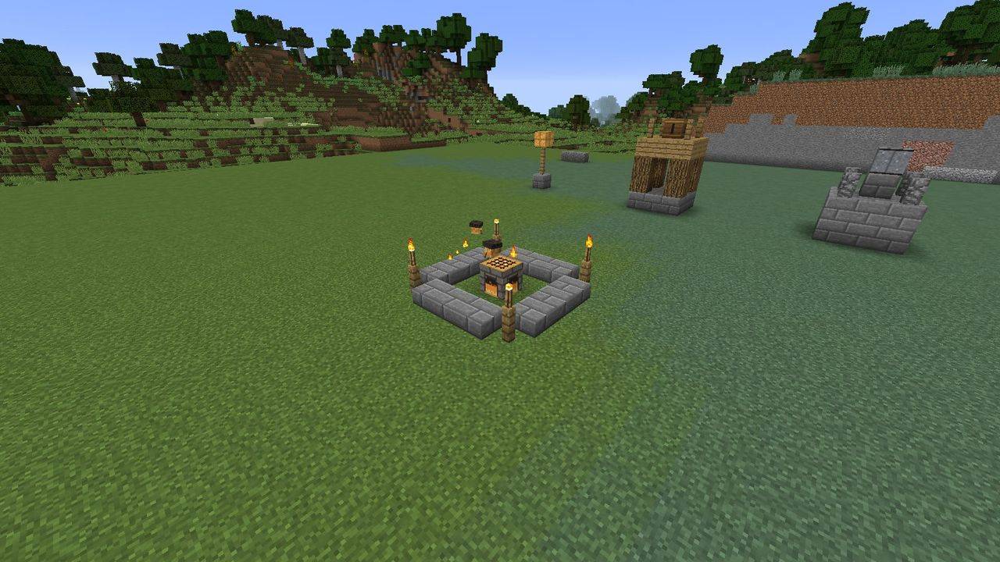
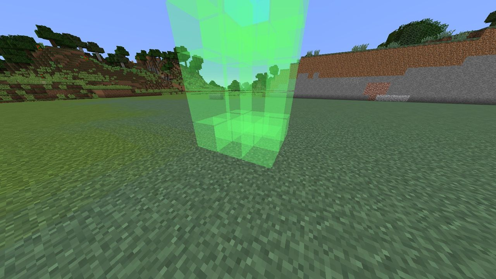
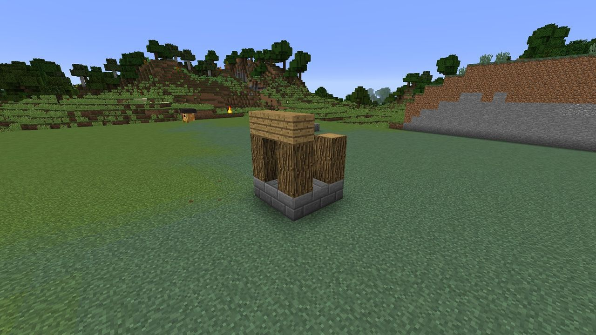
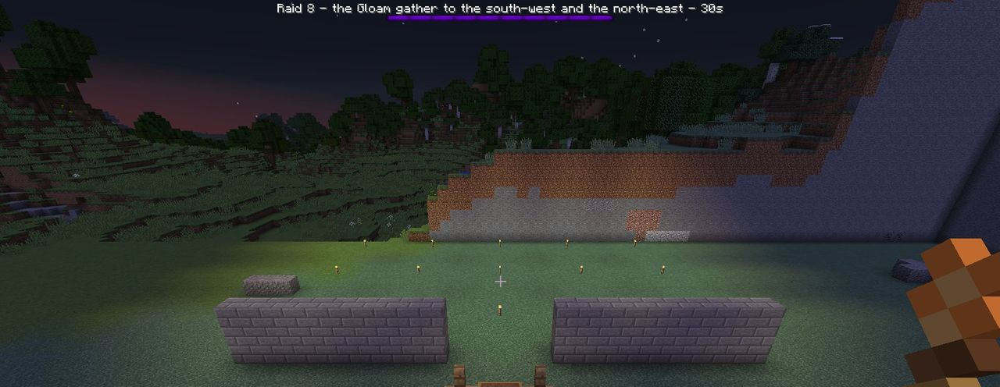

# Your first night

This walkthrough takes you from an empty field to a Hearth that has survived its first raid. It
assumes survival mode with LDTD's default settings. Allow one Minecraft day: set up in the
daytime, and the raid comes at dusk.

## What you need

| For | Items |
| --- | --- |
| The Hearth | 1 fire charge, 2 gold ingots, 1 furnace, 3 stone bricks |
| Its first growth stage | 4 fences, 12 stone brick slabs, 4 torches |
| An Archer Tower | 1 paper and 1 bow for the blueprint. To build it: 9 stone bricks, 8 logs, 9 planks, 4 fences and 16 arrows |
| A couple of walls | 1 paper and 1 stone brick for the blueprint, 15 stone bricks per wall |

Stone bricks are the backbone of almost everything, so smelt and craft a good stack of them
before you start.

## Step 1: Craft and place the Hearth

The Hearth is crafted from a fire charge on top, gold–furnace–gold in the middle and three stone
bricks along the bottom:

| | | |
| :---: | :---: | :---: |
| | Fire charge | |
| Gold ingot | Furnace | Gold ingot |
| Stone bricks | Stone bricks | Stone bricks |

Pick your spot with care. **The Hearth is the centre of everything**: its territory is a circle
around it that grows to a 64-block radius by level 5, and Hearths need plenty of room between
them. While you hold a Hearth, an ember-coloured fence shows the edge of every territory nearby.

Place it. The land within 24 blocks is now yours. You'll see
*Entering the territory of &lt;you&gt;'s Hearth* above the hotbar as you walk in.

## Step 2: Fill the stockpile

**Use** (right-click) the Hearth to open its stockpile, a 27-slot chest. Put in what you
gathered: stone bricks, slabs, planks, logs, fences, torches, arrows.

Within a few seconds the first **Hearth-sprite** appears over the Hearth, a small ember-spirit
with a soot cap. A level-1 Hearth keeps two, and a new one appears every ten seconds until it
has them. Their first job is the Hearth's own **growth stage**: a ring of slabs with a fence
and torch at each corner. They take the materials from the stockpile.

!!! tip "Is something stuck?"

    **Sneak-use the Hearth with an empty hand** to see its state. If the sprites are waiting for
    something, a second line says what: *Builders: 1 jobs and 0 repairs to go, waiting for 1 Oak
    Fence in the stockpile.*

## Step 3: Order an Archer Tower

Craft an **Archer Tower blueprint** from a paper and a bow (shapeless). Hold it and look at the
ground inside your territory: a translucent **ghost** shows exactly where the tower will go.
Green cells will be built, the cyan cell is the tower's core, and **red** means something is in
the way.

The tower is built facing the way you're facing. When the ghost is where you want it, **use**
the blueprint. You'll see *Archer Tower ordered*, and the sprites start carrying blocks over,
four at a time.

The blueprint isn't used up, so you can order as many towers as your stockpile can pay for.

!!! info "Where to put it"

    Between the Hearth and the edge of your territory, with a clear view around it. An Archer
    Tower reaches 20 blocks and needs a line of sight. See [Strategy tips](strategy.md) for more.

## Step 4: Add a wall or two

Craft a **Stone Wall blueprint** (paper and a stone brick). Each wall is 5 blocks long and 3 tall.
Walls don't stop the Gloam outright: they plan a route around them, and dig through when there's
no way around. What walls do is **buy time** in your towers' range, and **steer** the Gloam
past your towers.

## Step 5: Light it up

The Gloam hate light. A Gloam standing in **block light 10 or more** moves 15% slower and takes
50% more damage. Torches around your towers and along the approach help a lot, and so does a
**Lantern Post** (paper and glowstone dust), which glows at full brightness. See
[Light as a defense](../defenses/light.md).

## Step 6: Stay for the night

At dusk, if you're **within 96 blocks of your Hearth**, a raid gathers:

> *The Gloam gather to the north. Raid 1: 6 Shade. They come in 30 seconds.*

A purple boss bar appears with the countdown. When it runs out, the Gloam appear just outside
your territory on that side and march on the Hearth in **three waves**. The boss bar then shows
how many Gloam remain and how much **Flame** the Hearth has left.

Fight alongside your towers. The Gloam attack players within 10 blocks, so keep moving. Any Gloam
that reaches the Hearth stands there and drains the Flame, one point a second for a Shade.

The raid ends when every Gloam is dead (*The Hearth holds*), or at dawn (*Dawn breaks and the
Gloam fade*). Either way the Hearth pays **Duskglass** into the stockpile: 3 for your first raid,
one more for every raid after.

## Step 7: Spend your Duskglass

Collect the Duskglass from the stockpile, along with any the Gloam dropped. You have two choices:

- **Grow the Hearth.** Level 2 costs 8 Duskglass (held in your hand) and 32 stone bricks (in the
  stockpile). **Use** the Hearth while holding the Duskglass.
- **Upgrade a tower.** Tier II costs 10 Duskglass. **Sneak-use** the tower's core while holding
  it.

Early on, growing the Hearth is usually the better deal: more room, another sprite, and the
raids are sized partly by level anyway. See [Levels and growth](../hearth/levels.md).

## If the Hearth falls

If the Flame reaches zero, the raid ends at once. The Gloam withdraw, the Hearth goes cold, and a
quarter of every stack in the stockpile is lost. A cold Hearth claims no territory, so it has no
protection and no sprites at work.

Relight it by **using it with 8 coal**. The Flame comes back at half strength and refills on its
own between raids. See [The Flame, falling and relighting](../hearth/flame.md).

## What next

- [How the raids scale](../gloam/raids.md), and what each [Gloam unit](../gloam/bestiary.md)
  does.
- The other [towers](../defenses/towers.md), and [Ember Guards](../defenses/ember-guards.md) you
  can command.
- [Dusk Spires](../offense/dusk-spires.md), when you're ready to take the fight to them.
