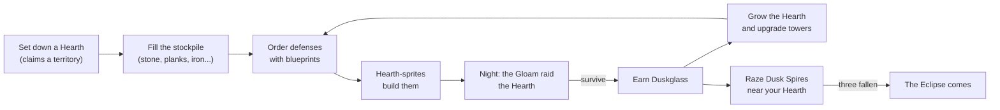

# How LDTD plays

LDTD turns your survival world into a tower-defense game, without taking it over. Nothing
happens until you set down a **Hearth**, and the Gloam can only ever damage blocks **inside a
Hearth's territory**. The rest of the world is safe.

## The loop

### 1. Claim land

A [Hearth](../hearth/index.md) is a block you craft and place. The land around it, a circle with a
24-block radius at first, becomes your **territory**. Towers can only stand inside a territory,
untrusted players can't build or break there, and the Gloam's sieges only ever happen there.

### 2. Stock up

The Hearth holds a 27-slot **stockpile**. You fill it with ordinary materials: stone bricks,
planks, logs, fences, iron, arrows and so on. Everything your defenses are built from comes out
of it.

### 3. Order defenses

Craft a [blueprint](../defenses/blueprints.md), hold it to see a ghost of the build, and use it
inside your territory. The order goes to the Hearth, and its [Hearth-sprites](../hearth/sprites.md),
small floating ember-spirits, fetch the materials from the stockpile and build it block by block.

There are five [towers](../defenses/towers.md) (Archer, Cannon, Frost, Lantern Post and Guard Post)
and a Stone Wall. Every tower is made of real blocks.

### 4. Hold the night

On nights when you are near your Hearth, the [Gloam](../gloam/index.md) come. You're told which
direction they gather from, and you have 30 seconds. Then they march on the Hearth in three
waves, around your walls when they can and through them when they can't.

Every Gloam that reaches the Hearth drains its **Flame**. If the Flame goes out, the Hearth falls
dark. That's painful, but never the end: you [relight it](../hearth/flame.md) with coal.

### 5. Grow

Every raid survived pays **Duskglass** into the stockpile, and the Gloam drop it when they die.
Duskglass does two things:

- Fed to the Hearth, it raises the Hearth's [level](../hearth/levels.md): a wider territory, more
  sprites, and a bigger hall that the sprites build around the Hearth.
- Used on a tower's core, it [upgrades the tower](../defenses/towers.md#upgrading) to tier II, then
  III.

Raids grow too. Each one is bought from a budget that rises with every raid survived and every
level you gain. See [Raids](../gloam/raids.md).

### 6. Strike back

[Dusk Spires](../offense/dusk-spires.md) stand in the wilds. They make the raids on nearby
Hearths bigger and decide where they come from. Dig into a spire, break its core, and it
crumbles. When three have fallen, [the Eclipse](../offense/eclipse.md) joins every raid on your
Hearth until you destroy it.

## What LDTD will never do

- **Damage blocks outside a territory.** Every block-damage path goes through the territory
  check, so a raid can't wreck the countryside or anything built outside a Hearth's claim.
- **Raid you while you're away.** A night raid needs the Hearth's owner online and within 96
  blocks. Nobody comes home to a ruined base.
- **Destroy your base for good.** A fallen Hearth loses a quarter of each stockpile stack and goes
  cold until you relight it. Your towers, walls and buildings stay.

!!! tip "Building only"

    A server can turn raids off entirely (`raids.enabled=false` in `config/ldtd.cfg`). LDTD then
    becomes a building mod: Hearths, territories, protection and sprite-built blueprints, with no
    Gloam.
